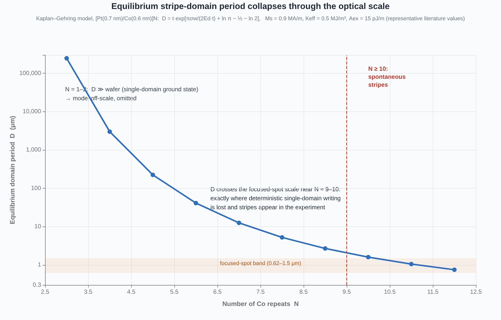
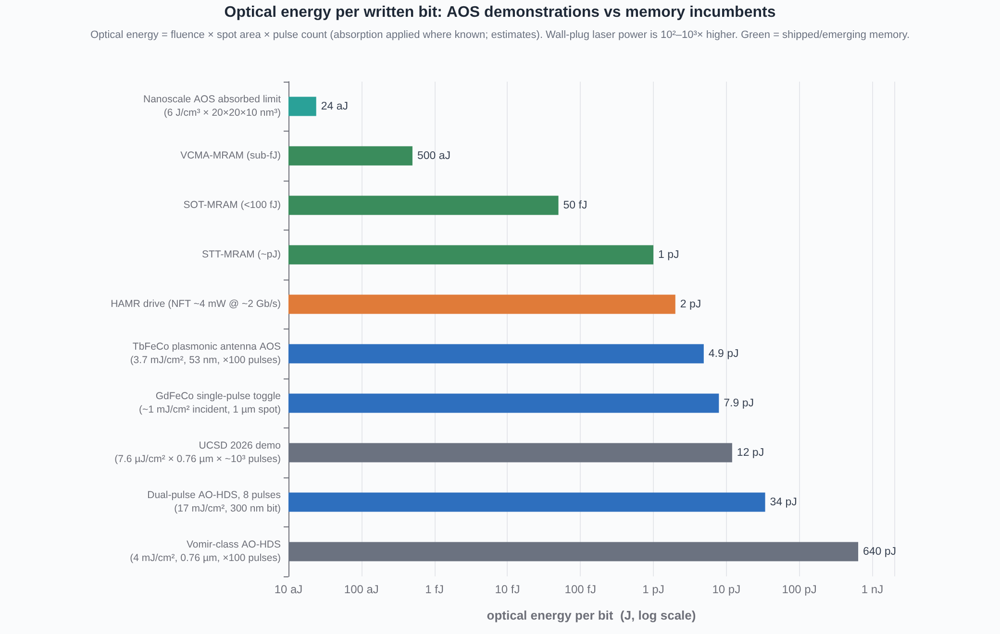
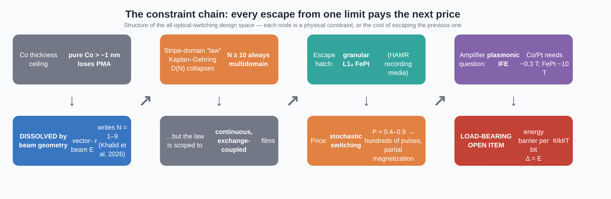

# The Constraint Chain of All-Optical Magnetic Recording

**A deep-research report on the UCSD vector-beam demonstration (Khalid et al., *Nature Communications* 2026), the design space it opens, and the load-bearing open measurement: the energy barrier per bit**

## TL;DR

The 2026 UCSD demonstration shows that beam geometry — not the magnetic stack — is now the binding constraint on all-optical switching (AOS) in Co/Pt-class media: by focusing circularly polarized vector beams to the diffraction limit, deterministic single-domain writing works in films from N = 1 to N = 9 Co repeats, a range previously thought inaccessible ([Khalid et al. 2026](https://www.nature.com/articles/s41467-026-77572-3)). Descending the constraint chain from that result, each escape from one physical limit exacts a price at the next: the stripe-domain "law" is dissolved by granularity only at the cost of stochastic, multi-hundred-pulse switching; the plasmonic inverse-Faraday-effect amplifier can plausibly close the field gap for Co/Pt-class media (threshold ~0.3 T) but not for FePt-class media (~10 T); and the entire question of whether the optically writable class of materials is also the recordable class reduces to one unmeasured quantity — **the energy barrier per written bit, Δ = E_B/k_BT, in an optically written domain**.

Coherent-volume estimates computed in Section 6 put Co/Pt within reach of the Δ ≥ 60 ten-year-retention criterion at bit sizes of ~6–12 nm — squarely in plasmonically accessible territory — but measured depinning barriers in comparable continuous Co films come out a factor of ~100 below macrospin estimates, so the coherent estimate cannot be trusted until someone performs the measurement. That measurement is a standard Sharrock time-dependent-coercivity protocol: afternoon-scale at a vibrating-sample magnetometer, week-scale with repeated MFM tracking of written bits. The report descends the constraint chain link by link — thickness ceiling, stripe law, granular escape, amplifier gap, barrier, latency, energy, integration — and closes with a three-branch decision table that this single number would trigger.

## 1. What the UCSD demonstration actually established

### 1.1 The experimental facts, as verified against the paper and its supplement

Khalid, Sadzi and co-workers at UC San Diego wrote magnetic bits into [Pt(0.7 nm)/Co(0.6 nm)]_N multilayers with N ranging from 1 to more than 10, using tightly focused circularly polarized vector beams (CPVBs) and read the results out by magnetic force microscopy ([Khalid et al. 2026](https://www.nature.com/articles/s41467-026-77572-3)). The headline findings are precise and quantitative. For N = 1–2, switching is helicity-dependent and cumulative, in line with a decade of all-optical helicity-dependent switching (AO-HDS) on such stacks. For N = 3, the behavior changes regime at a measured focal-spot diameter of **1.36 µm**: above that spot size the film responds helicity-dependently; below it, a deterministic, helicity-independent reversed domain is stabilized. For N = 5–9, deterministic single-domain writing survives only under the tightest focusing — the paper's NA ≥ 0.8 condition, corresponding to a ~0.76 µm spot — and for N ≥ 10 the film breaks into stripe domains no matter what the beam does ([Khalid et al. 2026](https://www.nature.com/articles/s41467-026-77572-3)). The written reversed domains measured **0.64–0.90 µm** in MFM (mean ≈ 0.77 µm), were written at sweep speeds of 1–30 µm/s, and required on the order of 10³ cumulative pulses per spot at the kHz repetition rate of the demonstration laser ([Khalid et al. 2026](https://www.nature.com/articles/s41467-026-77572-3), [UCSD Today](https://today.ucsd.edu/story/by-shaping-and-shrinking-light-engineers-alter-a-materials-magnetic-properties)).

The optical mechanism is as important as the magnetic one. A circularly polarized vector beam focused at high numerical aperture develops, via the Richards–Wolf focal-field structure, a strong longitudinal E_z component whose spatial distribution differs qualitatively from a scalar Gaussian focus; the paper shows that this engineered focal field is what confines the switched region inside the intrinsic domain size of the film ([Khalid et al. 2026](https://www.nature.com/articles/s41467-026-77572-3)). The price of using that field structure is alignment fragility: the "polarization filter" that produces the required field makes the working depth of focus collapse from roughly 17 µm toward ~2 µm as NA increases, so deterministic writing lives in a narrow window of defocus, NA, and fluence ([Khalid et al. 2026](https://www.nature.com/articles/s41467-026-77572-3)). Figure 1 of this report summarizes the resulting phase map of regimes in the (spot size, N) plane, which is the paper's essential contribution rendered as a design diagram: it tells a device engineer exactly where in parameter space a single, deterministic, reproducible bit can be written, and where the film instead answers with a multidomain mess.

![Switching phase map of [Pt/Co]N under vector-beam illumination: helicity-dependent (HD), deterministic helicity-independent single-domain (HI), and multidomain/stripe (MD) regimes, with the measured 1.36 µm transition at N = 3. Schematic after Khalid et al. 2026.](figures/fig6_phase_map.png)

Two features of the phase map deserve emphasis because they reframe what "all-optical switching" means for this material class. The first is that the helicity-independent (HI) deterministic regime is **dipolar-stabilized**: the reversed domain exists because magnetostatics favors it once the heated region is smaller than the intrinsic equilibrium domain period, which is the same physics identified earlier in Pt/Co/Pt trilayers ([El Hadri et al. 2016](https://arxiv.org/abs/1602.08525)). The second is that switching remains cumulative even in the HI regime — the bit is grown over ~10³ pulses, not toggled in one — which places the UCSD result, in the taxonomy of AOS, between the classic multi-pulse AO-HDS of Co/Pt and the true single-pulse AO-HIS toggle of ferrimagnetic GdFeCo ([Khalid et al. 2026](https://www.nature.com/articles/s41467-026-77572-3), [Kimel & Li 2019](https://www.nature.com/articles/s41578-019-0086-3)). This cumulative character is not a detail; it propagates directly into the latency and energy budgets of Section 7.

### 1.2 The mechanism stack: from photon to written bit

The physical chain established by the experiment has four links, each of which becomes a section of this report. The beam-shaping optics sets the spatial scale of the energy deposition and, through E_z, the symmetry of the drive. The heat pulse transiently demagnetizes a sub-micron region — Co/Pt reaches electron temperatures of order 1100 K at fluences of ~7.6 µJ/cm² in related single-shot experiments, i.e., above the effective Curie threshold ([Vomir et al. 2017](https://arxiv.org/abs/1710.10341), [Cheng et al. 2023](https://pmc.ncbi.nlm.nih.gov/articles/PMC10621044/)). During cooling, helicity-dependent absorption (magnetic circular dichroism, MCD) and the inverse Faraday effect (IFE) bias regrowth so that one magnetization direction is preferred; the Yamada group's spectral analysis showed MCD dominates the helicity-dependent channel in Pt/Co/Pt, with a helicity-dependent absorption coefficient of ~1.5% producing ~2.7 K/nm thermal gradients across a domain wall ([Yamada et al. 2022](https://www.frontiersin.org/journals/nanotechnology/articles/10.3389/fnano.2022.765848/full)). Finally, magnetostatics either stabilizes the reversed domain (sub-domain-scale spot) or dissolves it into stripes (spot larger than the equilibrium domain period, or N ≥ 10) ([Khalid et al. 2026](https://www.nature.com/articles/s41467-026-77572-3)).

It is worth stating explicitly what the demonstration did **not** establish, because the popular summary of such results tends to overreach. It did not demonstrate single-pulse switching: every written bit is the integral of ~10³ pulses. It did not demonstrate nanoscale bits: the written domains are ~0.77 µm, set by the diffraction-limited spot. It did not measure retention: nothing in the paper or supplement speaks to how long an optically written bit survives at temperature. And it did not demonstrate a device: the write head is a free-space microscope objective, the readout is MFM, and the laser is a table-top kHz system ([Khalid et al. 2026](https://www.nature.com/articles/s41467-026-77572-3)). These four "not-yets" map one-to-one onto the open items that decide whether the result is a physics milestone or a technology foundation — and two of them (single-pulse budget and bit size) have independent literature baselines that Sections 5 and 7 develop, while the third (retention) is the core open measurement analyzed in Section 6.

### 1.3 Three corrections to the circulating narrative

A transcript accompanying this research brief made three claims that the primary literature does not support, and a rigorous report should correct them explicitly. First, the claim that "coherent nonthermal IFE switching has been demonstrated, see arXiv:2104.11820" is wrong in a subtle but important way: that paper (Dannegger et al.) is a density-functional-theory-plus-atomistic-spin **simulation** of IFE-driven switching in the CrPt *antiferromagnet*, not an experiment, and it concerns an antiferromagnet, not a recording-grade ferromagnet ([Dannegger et al. 2021](https://arxiv.org/abs/2104.11820)). Coherent, nonthermal IFE switching of a ferromagnetic recording material remains undemonstrated; what exists are simulations, thermal-mediated IFE contributions, and MCD-dominated channels. Second, the claim that granular-media switching "reaches only 10–20% of saturation" understates the real, measured numbers: Takahashi et al. achieved ~66% net remanence in granular FePt media after ~500 pulses, and John et al. measured per-pulse up- and down-write probabilities of 63% and 41% — poor enough to force multi-pulse averaging, but far above 10–20% ([Takahashi et al. 2016](https://arxiv.org/abs/1604.03488), [John et al. 2017](https://www.nature.com/articles/s41598-017-04167-w)). Third, for the record, the paper appeared online on 15 September 2026 and the university news story on 25 September 2026 — minor, but the two dates circulate conflated ([Khalid et al. 2026](https://www.nature.com/articles/s41467-026-77572-3), [UCSD Today](https://today.ucsd.edu/story/by-shaping-and-shrinking-light-engineers-alter-a-materials-magnetic-properties)).

The first correction is the one with real analytical weight, because it changes what the "amplifier question" of Section 5 can lean on. If coherent IFE switching were an established experimental fact in a recording material, the question "can plasmonics close the IFE gap?" would have an existence proof behind it; it does not. What the literature actually offers is (a) a well-measured effective-field threshold of ~0.3 T for >90% AO-HDS completion in Co/Pt-class films, (b) evidence that IFE alone is too weak in FePt and that MCD carries the helicity dependence there, and (c) measured plasmonic IFE enhancements of 7–15× in model magneto-plasmonic structures ([Cheng et al. 2023](https://pmc.ncbi.nlm.nih.gov/articles/PMC10621044/), [Ellis et al. 2016](https://www.nature.com/articles/srep30522), [González-Alcalde et al. 2024](https://pmc.ncbi.nlm.nih.gov/articles/PMC11501565/)). The amplifier question is therefore an engineering extrapolation from measured enhancement factors, not a physics question awaiting its first observation — which is precisely why the retention question, not the mechanism question, is the load-bearing one.

## 2. The thickness ceiling, and how beam geometry dissolves it

### 2.1 The old constraint: interfacial anisotropy against the demagnetizing field

Perpendicular magnetic anisotropy (PMA) in Co/Pt multilayers is an interface effect: hybridization between Co 3d and Pt 5d orbitals at each interface contributes an anisotropy energy of order **K_s ≈ 0.3 mJ/m² per interface**, so a stack's total perpendicular bias scales with interface count, not with magnetic volume ([IEEE Magnetics Society](https://technav.ieee.org/topic/perpendicular-magnetic-anisotropy/), [Khalid et al. 2026](https://www.nature.com/articles/s41467-026-77572-3)). The competing term is the demagnetizing energy, μ₀M_s²/2 ≈ 0.5 MJ/m³ for Co-rich layers, which favors in-plane magnetization. The effective volume anisotropy, K_eff = 2K_s/t_Co − μ₀M_s²/2 (+ bulk terms), therefore changes sign as the Co layer thickens: pure Co loses PMA beyond ~1–2 nm, and a single thick Co film cannot serve as a perpendicular medium. The classical fix — repeating [Co/Pt] N times to accumulate interfaces — buys PMA at the price of making the film magnetically thicker and, as Section 3 develops, dragging it into the stripe-domain regime. This is the first link of the constraint chain: **the materials route to stronger PMA is also the route to losing single-domain writability** ([IEEE Magnetics Society](https://technav.ieee.org/topic/perpendicular-magnetic-anisotropy/), [Khalid et al. 2026](https://www.nature.com/articles/s41467-026-77572-3)).

Until the UCSD work, the AOS literature had internalized this ceiling as a materials boundary: AO-HDS demonstrations concentrated on N = 1–4 stacks (Pt/Co/Pt trilayers and short multilayers), because those were the films whose intrinsic domain structure tolerated deterministic optical writing, while thicker exchange-coupled stacks were assumed stripe-dominated and thus unusable ([Lambert et al. 2014](https://www.science.org/doi/10.1126/science.1253493), [El Hadri et al. 2016](https://arxiv.org/abs/1602.08525)). The thickness ceiling was therefore doubly constraining. From below, few-layer films have little magnetic material per bit — a weak readout signal and a small barrier. From above, many-layer films break into stripes. The usable window looked like N ≈ 1–4, and even there only with helicity-dependent multi-pulse protocols.

### 2.2 The geometric dissolution

The UCSD result relocates the constraint from the stack to the optics. Because deterministic writing requires the heated region to be smaller than the equilibrium domain period — a magnetostatic, not a materials, condition — shrinking the spot with a high-NA vector-beam focus reopens N = 5–9, and the same logic applies downward: N = 1–2 films switch (helicity-dependently) and N = 3 sits exactly at the measured 1.36 µm crossover ([Khalid et al. 2026](https://www.nature.com/articles/s41467-026-77572-3)). In other words, the "thickness ceiling" was never a ceiling on the material; it was a ceiling on the **ratio of spot size to intrinsic domain period**. The beam does not change the film's anisotropy; it changes which films are writable by making the writable window a function of NA. This is why the report's framing treats the demonstration as dissolving, rather than circumventing, the ceiling: nothing about the Co/Pt stack was improved, and everything about the accessible parameter space was.

There is a subtlety worth flagging for stack designers, and it connects forward to the barrier question of Section 6. The demonstration's writability argument is about the *initial* stabilization of a reversed domain in a heated region. The retention of that same bit over years is a different energy scale — the barrier against thermally activated nucleation and wall motion — and it depends on K_eff and on the *magnetic* volume of the bit, not on the optical one. Beam geometry dissolves the thickness ceiling for writing; it does nothing, by itself, for the thickness ceiling for storing. A 0.6 nm Co layer in an N = 1 stack is optically writable in the UCSD protocol and, simultaneously, the worst retention candidate in the whole family — which is why Section 6 treats the barrier per bit, rather than the writability map, as the deciding quantity ([Khalid et al. 2026](https://www.nature.com/articles/s41467-026-77572-3), [Weller & Moser 1999](https://ieeexplore.ieee.org/document/809134)).

## 3. The stripe-domain "law" and its proper scope

### 3.1 The Kaplan–Gehring mechanics, computed

In a continuous, exchange-coupled perpendicular film, the competition between wall energy and demagnetizing energy sets an equilibrium stripe period. In the form used in the UCSD supplement — the Kaplan–Gehring model — the equilibrium period is D = t·exp[πσ_w/(2E_d t) + ln π − 1/2 − ln 2], where t is the magnetic thickness, σ_w = 4√(A_ex·K_eff) the wall energy density per area, and E_d = μ₀M_s²/2 the demagnetizing energy density ([Khalid et al. 2026](https://www.nature.com/articles/s41467-026-77572-3)). Evaluating this expression for the demonstration's [Pt(0.7)/Co(0.6)]_N family with representative literature parameters (M_s = 0.9 MA/m, K_eff = 0.5 MJ/m³, A_ex = 15 pJ/m) gives the collapse shown in Figure 2: N = 3 sits at a quarter of a *meter* — effectively monodomain on any sample — while N = 9 lands at **2.7 µm**, N = 10 at **1.6 µm**, and N = 12 at 0.75 µm, i.e., the equilibrium period crashes through the focused-spot scale (0.62–1.5 µm) precisely at N ≈ 9–10, exactly where the experiment loses deterministic single-domain writing and stripes appear spontaneously.

| N (Co repeats) | Magnetic thickness t (nm) | Computed equilibrium period D | Regime vs. focused spot (~0.76–1.36 µm) |
|---|---|---|---|
| 1–2 | 0.6–1.2 | ≫ sample (model off-scale) | monodomain ground state; HD switching ([Khalid et al. 2026](https://www.nature.com/articles/s41467-026-77572-3)) |
| 3 | 1.8 | ~2.5 × 10⁵ µm (this work, model) | D ≫ spot; measured crossover at 1.36 µm spot ([Khalid et al. 2026](https://www.nature.com/articles/s41467-026-77572-3)) |
| 5 | 3.0 | ~224 µm (this work, model) | D ≫ spot; HI writing needs NA ≥ 0.8 ([Khalid et al. 2026](https://www.nature.com/articles/s41467-026-77572-3)) |
| 7 | 4.2 | ~12.5 µm (this work, model) | approaching optical scale |
| 9 | 5.4 | **~2.7 µm** (this work, model) | within ~3× of the tightest spot; deterministic writing marginal |
| 10 | 6.0 | **~1.6 µm** (this work, model) | at the spot scale; stripes observed ([Khalid et al. 2026](https://www.nature.com/articles/s41467-026-77572-3)) |
| 12 | 7.2 | ~0.75 µm (this work, model) | below the spot; stripes unavoidable |

Two honest caveats attach to this table, and both matter for how the "law" should be quoted. The Kaplan–Gehring exponent depends exponentially on σ_w/(E_d·t), so the absolute numbers swing by orders of magnitude across the literature parameter envelope (for N = 9 the same model spans 0.13 µm to 2.5 mm across plausible corners of M_s, K_eff and A_ex); what is robust is the *trend* and the crossover region, not the third digit. And the model assumes a laterally uniform, exchange-coupled film — which is the scope condition of the next subsection. With those caveats, the qualitative statement is solid and independently confirmed by the experiment: **the equilibrium domain period of the [Pt/Co]_N family falls through the diffraction-limited optical scale at N ≈ 9–10**, and the paper's MFM data — stripes at N ≥ 10, deterministic domains below — is exactly that crossover observed in the laboratory ([Khalid et al. 2026](https://www.nature.com/articles/s41467-026-77572-3)).

### 3.2 Scope: the law governs continuous films, not grains

The stripe-domain "law" is frequently quoted as if it were a property of perpendicular magnets generally. It is not. Its derivation assumes exchange stiffness across the whole film plane — the wall energy σ_w only exists because neighboring spins are exchange-coupled — and its catastrophic N-scaling only exists because the demagnetizing energy of a *continuous* perpendicular film grows with magnetic thickness. Break the lateral exchange and the premises evaporate: an assembly of magnetically isolated grains has no wall to pay for, no film-scale demagnetizing field to minimize, and each grain's stability is set by its own K_u V, not by a collective stripe period ([Tozman et al. 2023](https://arxiv.org/abs/2307.02213), [Zhang et al. 2011](http://homepage.ntu.edu.tw/~jiayang/papers/2011L10-orderedFePtAg-C.pdf)). This is the precise sense in which granular media "escape" the law — not by beating the energy balance, but by voiding its assumptions.

This scoping has a direct engineering consequence that the UCSD phase map makes visible. In continuous films, the writable window is squeezed from both sides: N too small gives HD-only cumulative switching and weak magnetic volume, N too large gives stripes. The squeeze is why the granular escape hatch — Section 4 — is so attractive on paper, and why its stochastic price is so disappointing in practice. It also explains the otherwise puzzling coexistence in the literature of micron-scale single-shot switching in thin Pt/Co/Pt (where D is macroscopic and the film is monodomain) with the complete failure of deterministic writing in thick stacks: both are the same Kaplan–Gehring curve, read at different N ([Vomir et al. 2017](https://arxiv.org/abs/1710.10341), [Khalid et al. 2026](https://www.nature.com/articles/s41467-026-77572-3)). The "law" is one equation; the design space is the set of ways to step outside its jurisdiction — granularity (Section 4), sub-domain-scale optics (the UCSD route), or ferrimagnetic compensation (the GdFeCo route of Section 7).

## 4. The granular escape hatch — and the stochastic price it charges

### 4.1 The escape: L1₀ FePt and the HAMR precedent

The granular route out of the stripe-domain jurisdiction is mature, quantified, and — uniquely in this report — already shipping in volume. Chemically ordered L1₀ FePt has a uniaxial magnetocrystalline anisotropy of **K_u ≈ 7 MJ/m³**, roughly an order of magnitude above the effective anisotropy of Co/Pt stacks, which lets grains as small as ~4 nm satisfy the thermal-stability condition K_uV/k_BT > 60 that anchors ten-year retention ([Tozman et al. 2023](https://arxiv.org/abs/2307.02213), [Weller & Moser 1999](https://ieeexplore.ieee.org/document/809134)). That anisotropy is precisely why FePt cannot be written by conventional heads — coercivities demand fields beyond ~3 T — and why the industry wrapped it in a thermal assist: HAMR heats the medium through its Curie region so that a sub-Tesla field can write it, then lets it cool into a state whose barrier is enormous ([Tozman et al. 2023](https://arxiv.org/abs/2307.02213), [Seagate 2024](https://investors.seagate.com/news/news-details/2024/Seagates-Breakthrough-30TB-Hard-Drives-Ramp-Volume-Marking-an-Inflection-Point-in-the-Storage-Industry/default.aspx)). The measured barrier in a production-relevant FePtAg–C granular film is **E_b = 7.6 eV ≈ 300 k_BT** (Sharrock analysis of time-dependent remnant coercivity), against ~80 k_BT for legacy CoCrPt media — granular FePt does not merely satisfy the retention criterion, it overshoots it by a factor of five ([Zhang et al. 2011](http://homepage.ntu.edu.tw/~jiayang/papers/2011L10-orderedFePtAg-C.pdf)).

The commercial status matters for what follows, because it converts "granular FePt" from a materials hypothesis into a calibrated industrial baseline. Seagate's Mozaic 3+ platform — granular FePt media, plasmonic near-field transducer, ~3 TB per platter — ramped to volume shipments of 30 TB+ drives in early 2024 and passed **one million drives shipped** by mid-2025, with 4 TB+ and 5 TB+ per-platter generations in productization and lab demonstration respectively ([Seagate 2024](https://investors.seagate.com/news/news-details/2024/Seagates-Breakthrough-30TB-Hard-Drives-Ramp-Volume-Marking-an-Inflection-Point-in-the-Storage-Industry/default.aspx), [Seagate 2025](https://investors.seagate.com/news/news-details/2025/Seagate-Ships-30TB-Drives-to-Meet-Global-Surge-in-Data-Center-AI-Storage-Demand/default.aspx)). Any all-optical scheme aimed at recording is therefore not competing with a hypothetical; it is competing with a shipping, roadmapped, laser-integrated technology that already solved granularity, retention, and thermal delivery — albeit with a magnetic field still in the loop. The honest framing for AOS-in-granular-media is not "can we make granular work" but "can we remove the field from a machine that already works."

### 4.2 The price: per-grain Bernoulli switching

The measured answer, so far, is that removing the field converts a deterministic write into a lottery. When Takahashi et al. drove granular FePt–C media (the same materials family as HAMR platters) with circularly polarized femtosecond pulses, individual grains switched with a per-pulse probability of only **P₁ = 0.0048**, so converging the magnetization required ~500 pulses, and the converged state reached just **~66% of saturation**; pushing beyond 90% required a +0.2 T assist field, and pushing the fluence damaged the medium above ~1.5 mW ([Takahashi et al. 2016](https://arxiv.org/abs/1604.03488)). John et al. measured the same physics from the domain side: single-pulse up-write and down-write probabilities of **63% and 41%**, with persistence parameters w_uu = 0.86 and w_du = 0.38 showing that a grain's fate depends strongly on its prior state and on local heterogeneity — the signature of a per-grain energy landscape dominated by distributions of K_u, T_c and local thermal environment rather than by a uniform, deterministic drive ([John et al. 2017](https://www.nature.com/articles/s41598-017-04167-w)). Lambert et al. had already shown that the helicity-dependent effect extends to high-anisotropy granular films, including FePt-based media that required multi-Tesla fields (up to 7 T) merely to initialize ([Lambert et al. 2014](https://www.science.org/doi/10.1126/science.1253493)).

The physical picture behind these numbers is the dual role of granularity. Isolation voids the stripe law and raises the barrier — the wins of Section 4.1 — but it also removes the collective phenomena that make continuous-film switching deterministic. There is no domain wall to drag coherently across the spot by an MCD-driven thermal gradient, no exchange stiffness to synchronize neighboring moments, and no compensation dynamics as in ferrimagnets; each ~5 nm grain is an independent thermal oscillator with its own K_u, its own T_c, and its own local fluence, and the femtosecond heat pulse flips it with some probability that the beam can bias but not fix ([Takahashi et al. 2016](https://arxiv.org/abs/1604.03488), [John et al. 2017](https://www.nature.com/articles/s41598-017-04167-w)). The consequences propagate straight into the device budget. Multi-pulse convergence at P₁ ≈ 0.005 means **hundreds of pulses per bit** — the latency ladder of Section 7 shows this is the single largest latency liability in the entire AOS design space. Partial convergence (~66%) means the written bit carries reduced readback amplitude, trading away exactly the signal margin that high-anisotropy media were chosen to protect. And the +0.2 T assist required for >90% completion means that even after five hundred pulses, "all-optical" granular writing quietly reintroduces the field it promised to eliminate ([Takahashi et al. 2016](https://arxiv.org/abs/1604.03488)).

| Medium class | K_u (effective) | Thermal stability Δ at 300 K | AOS modality | Pulses per full write | Field needed? | Status |
|---|---|---|---|---|---|---|
| Co/Pt multilayer (N = 1–4) | ~0.3–0.6 MJ/m³ | unmeasured for optical bits (Sec. 6) | AO-HDS, cumulative, dipolar-stabilized HI | ~10²–10³ | no | deterministic in films ([Khalid et al. 2026](https://www.nature.com/articles/s41467-026-77572-3)) |
| Co/Pt multilayer (N = 5–9) | ~0.3–0.6 MJ/m³ | unmeasured for optical bits (Sec. 6) | vector-beam HI, cumulative | ~10³ (demo) | no | deterministic only at NA ≥ 0.8 ([Khalid et al. 2026](https://www.nature.com/articles/s41467-026-77572-3)) |
| Granular L1₀ FePt (HAMR media) | ~7 MJ/m³ | measured ~300 k_BT ([Zhang et al. 2011](http://homepage.ntu.edu.tw/~jiayang/papers/2011L10-orderedFePtAg-C.pdf)) | stochastic per-grain | ~500 to converge | +0.2 T for >90% | partial (~66%) ([Takahashi et al. 2016](https://arxiv.org/abs/1604.03488)) |
| Ferrimagnet GdFeCo | low (~10⁴–10⁵ J/m³) | device-stable ≥ ~200 nm only ([Kimel & Li 2019](https://www.nature.com/articles/s41578-019-0086-3)) | AO-HIS single-pulse toggle | 1 | no | deterministic, low density ceiling ([Kimel & Li 2019](https://www.nature.com/articles/s41578-019-0086-3)) |

Reading the table vertically exposes the structure of the whole problem: **deterministic writability and measured retention have never yet coexisted in one material system**. Co/Pt writes deterministically and has no measured barrier; FePt has a superb measured barrier and writes stochastically; GdFeCo toggles in one pulse but cannot hold a sub-200 nm bit against thermal agitation. Every escape from one constraint lands inside the next one — which is the constraint chain of Figure 6 — and it is why the report's analytical spine is the barrier per bit: it is the only quantity that can decide whether the deterministic column and the retention column can ever share a row.

## 5. The amplifier question: can plasmonics close the IFE gap?

### 5.1 What the IFE would have to deliver

The inverse Faraday effect converts circularly polarized light into an effective magnetic field along the beam axis, and in the AOS narrative it is the candidate mechanism for a clean, nonthermal, polarization-keyed write. The measured thresholds define the engineering gap precisely. In Co/Pt-class films, AO-HDS completion above 90% requires an effective out-of-plane field of about **H_z ≈ 0.3 T** (established by comparing switching probability against applied-field baselines in Pt/Co/Pt) ([Cheng et al. 2023](https://pmc.ncbi.nlm.nih.gov/articles/PMC10621044/)). At the microscopic level, the induced moment needed to steer reversal is likewise small for this class: atomistic analyses put the IFE-induced threshold near **Δm ≈ 0.05 µB per atom** against an optimal 0.4–0.6 µB, while the helicity-dependent absorption channel (MCD) in the same materials runs at a few percent and rises toward ~6% at resonance ([Kohlmann et al. 2024](https://arxiv.org/html/2401.18010v2)). For FePt the situation is qualitatively worse: direct assessment concluded that the IFE-induced field in FePt is too small to account for observed switching by orders of magnitude — the switching there is carried by helicity-dependent absorption and thermal gradients, i.e., MCD physics, not IFE ([Ellis et al. 2016](https://www.nature.com/articles/srep30522)). The often-quoted "demonstration" of coherent nonthermal IFE switching is, as corrected in Section 1.3, a simulation on an antiferromagnet ([Dannegger et al. 2021](https://arxiv.org/abs/2104.11820)).

Two conclusions follow before any plasmonics enters. The IFE gap is **material-class dependent**: for Co/Pt it is a factor-of-several to factor-of-ten problem (0.05 µB achieved-scale versus 0.4–0.6 µB optimal-scale, or equivalently bridging to the 0.3 T effective-field threshold), while for FePt it is a factor-of-hundreds problem and possibly the wrong mechanism altogether ([Kohlmann et al. 2024](https://arxiv.org/html/2401.18010v2), [Ellis et al. 2016](https://www.nature.com/articles/srep30522)). And because MCD carries much of the helicity dependence in practice, the "amplifier" does not have to amplify the IFE alone: enhancing *absorption asymmetry* and local fluence serves the same write channel through the MCD route, which the Yamada spectral analysis identified as dominant in Pt/Co/Pt ([Yamada et al. 2022](https://www.frontiersin.org/journals/nanotechnology/articles/10.3389/fnano.2022.765848/full)). This distinction — IFE-field amplification versus absorption/thermal-gradient amplification — is not pedantry; it decides which plasmonic figures of merit (local E-field, local absorption, circular asymmetry) actually matter.

### 5.2 Measured plasmonic enhancements, and what they can and cannot buy

The measured enhancement catalog is now substantial. Direct measurements of the IFE in Au-nanodisk magneto-plasmonic structures found plasmonic amplification of the inverse-Faraday response by factors of **7–15×** ([González-Alcalde et al. 2024](https://pmc.ncbi.nlm.nih.gov/articles/PMC11501565/)). Surface lattice resonances in periodic [Co/Gd/Pt] nanodisk arrays cut the single-pulse switching energy by **~400%** relative to continuous films while enhancing the magneto-optical Faraday readout by up to 5000% ([Vergès et al. 2023](https://pubmed.ncbi.nlm.nih.gov/36507620/)). On the spatial side — the other half of what an amplifier must deliver — plasmonic near-field transducers written into TbFeCo produced switched domains of **53 nm** at 3.7 mJ/cm², and Au nanostructures on GdTbCo localized single-pulse AO-HIS down to a **240 nm** critical dimension, well inside the free-space diffraction limit at the 1030 nm drive wavelength ([SPIE 2016](https://www.spie.org/news/6255), [Sidiropoulos et al. 2024](https://arxiv.org/abs/2408.13079)). Meanwhile MCD itself is resonantly enhanced a few-fold in magneto-plasmonic lattices, feeding the absorption channel ([Kohlmann et al. 2024](https://arxiv.org/html/2401.18010v2)).

Putting the two halves together gives a defensible engineering verdict. For the **Co/Pt class**: a 7–15× IFE amplification applied to an effect that is already within a factor of several of the 0.3 T threshold is plausibly sufficient, and the SLR result demonstrates that threshold-fluence reductions of the same order are real in practice, not just in coupling-coefficient models ([González-Alcalde et al. 2024](https://pmc.ncbi.nlm.nih.gov/articles/PMC11501565/), [Vergès et al. 2023](https://pubmed.ncbi.nlm.nih.gov/36507620/)). The plasmonic structures additionally solve the spot-size problem into the 50–250 nm range — exactly the bit sizes where Section 6 shows the retention question becomes binding ([SPIE 2016](https://www.spie.org/news/6255), [Sidiropoulos et al. 2024](https://arxiv.org/abs/2408.13079)). For the **FePt class**: the same 7–15× cannot reach the ~10 T-scale effective fields that deterministic FePt switching would demand, and the mechanism analysis says the IFE is the wrong lever there anyway ([Ellis et al. 2016](https://www.nature.com/articles/srep30522)). The amplifier question therefore resolves into a class selection: **plasmonics makes the IFE-friendly class (Co/Pt-type, low-K, dipolar-stabilized) smaller and cheaper to write; it does not promote the retention-proven class (granular FePt) into deterministic optical writability**. Whether the IFE-friendly class is also the recording class is then, once again, the barrier question — which is why it is the load-bearing item, and why the transcript's closing claim survives every correction applied so far.

| Quantity | Co/Pt class | FePt class | Plasmonic amplifier can deliver | Gap closes? |
|---|---|---|---|---|
| Effective field for deterministic write | ~0.3 T ([Cheng et al. 2023](https://pmc.ncbi.nlm.nih.gov/articles/PMC10621044/)) | ~10 T-scale (IFE route impractical) ([Ellis et al. 2016](https://www.nature.com/articles/srep30522)) | 7–15× IFE ([González-Alcalde et al. 2024](https://pmc.ncbi.nlm.nih.gov/articles/PMC11501565/)) | Co/Pt: plausibly yes; FePt: no |
| Microscopic induced moment needed | ~0.05 µB threshold vs 0.4–0.6 µB optimal ([Kohlmann et al. 2024](https://arxiv.org/html/2401.18010v2)) | n/a (MCD-dominated) | resonant absorption enhancement | partially |
| Switching fluence threshold | 1.9–17 mJ/cm² class ([Yamada et al. 2022](https://www.frontiersin.org/journals/nanotechnology/articles/10.3389/fnano.2022.765848/full)) | damage-limited ([Takahashi et al. 2016](https://arxiv.org/abs/1604.03488)) | ~400% reduction via SLR ([Vergès et al. 2023](https://pubmed.ncbi.nlm.nih.gov/36507620/)) | yes, demonstrated |
| Spatial confinement | diffraction-limited 0.76 µm ([Khalid et al. 2026](https://www.nature.com/articles/s41467-026-77572-3)) | needs ≤50 nm bits | 53–240 nm demonstrated ([SPIE 2016](https://www.spie.org/news/6255), [Sidiropoulos et al. 2024](https://arxiv.org/abs/2408.13079)) | yes, demonstrated |

## 6. The energy barrier per bit: the load-bearing open measurement

### 6.1 The criterion and why the whole industry is organized around it

Magnetic retention is an Arrhenius problem: a bit flips spontaneously when thermal energy overcomes the anisotropy barrier, and the mean time to failure scales as τ₀·exp(Δ) with Δ = E_B/k_BT and τ₀ ~ 10⁻⁹–10⁻¹⁰ s. Demanding ten-year storage against this exponential gives the canonical criterion **Δ ≥ 60** (grain-size-dispersion dependent, ~60 for projected densities under ten-year storage conditions), the number around which the entire recording-media industry has been organized for a quarter century ([Weller & Moser 1999](https://ieeexplore.ieee.org/document/809134), [Tozman et al. 2023](https://arxiv.org/abs/2307.02213)). The criterion is not a recording-industry idiosyncrasy: the MRAM community optimizes the same quantity, and imec's 2024 SOT-MRAM free-layer redesign was celebrated specifically for lifting retention from **Δ ~ 50 to ~90** while holding the write error rate at specification — evidence that even a nanosecond-class memory treats Δ as a first-class design variable ([imec 2024](https://www.imec-int.com/en/articles/bringing-sot-mram-technology-closer-last-level-cache-memory-specifications)).

The asymmetry that makes Δ "load-bearing" for the present question is that it is the *only* recording criterion with no published measurement for an optically written bit. Writability is measured (the phase map of Section 1). Speed is measured (<20 ps write–read events in ferrimagnets) ([Kimel & Li 2019](https://www.nature.com/articles/s41578-019-0086-3)). Energy is measured or computable from measured fluences (Section 7). Scalability is measured down to 53–240 nm by plasmonic confinement ([SPIE 2016](https://www.spie.org/news/6255), [Sidiropoulos et al. 2024](https://arxiv.org/abs/2408.13079)). Retention of an optically written domain — the barrier that the written pattern actually sits behind — appears nowhere in the AOS literature as a direct measurement, in any material class, as of October 2026. Every claim that AOS is a candidate *recording* technology silently assumes the barrier of the medium transfers unchanged to the bit written in it; Section 6.3 shows why that assumption is exactly the one that fails in continuous films.

### 6.2 The coherent-volume estimate — and its surprising verdict

The first-pass estimate treats the bit as a Stoner–Wohlfarth particle: E_B = K_eff·A·t for a Co/Pt square bit of lateral size L and magnetic thickness t, and E_B = K_u·(π/4)D²·t for a cylindrical FePt grain. Figure 3 shows the result at 300 K across lateral sizes from 5 to 200 nm, computed from the parameters of Sections 2 and 4. The Δ = 60 crossings land at: **FePt grain ≈ 2.5 nm** (K_u = 5 MJ/m³, t = 10 nm); **Co/Pt (12 nm thick, K_eff = 0.5 MJ/m³) ≈ 6.4 nm**; **Co/Pt (UCSD N = 9 stack, 5.4 nm, K_eff = 0.5 MJ/m³) ≈ 9.6 nm**; and **Co/Pt (5.4 nm, K_eff = 0.3 MJ/m³) ≈ 12.4 nm**. At a 30 nm bit side — comfortably inside the 53–240 nm confinement that plasmonics has already demonstrated — every configuration in the figure sits at Δ = 350–1300, ten to forty times *above* the retention line.

Read naively, this is a startling result: **the IFE-friendly class is not obviously disqualified from recording**. The intuition that "Co/Pt is soft and therefore cannot hold a bit" is wrong at the coherent level — a 0.5 MJ/m³ effective anisotropy over a 12 nm-thick, 30 nm-wide bit is an enormous barrier, larger in absolute k_BT units than the measured FePtAg–C value of ~300 k_BT ([Zhang et al. 2011](http://homepage.ntu.edu.tw/~jiayang/papers/2011L10-orderedFePtAg-C.pdf)). The low anisotropy is compensated by volume: Co/Pt bits can afford to be thicker and laterally larger than FePt grains while remaining far below the optical confinement scale. If bits in continuous Co/Pt films reversed coherently, the transcript's closing question — "one measurement decides whether the IFE-friendly class is the recording class" — would already be answered in the affirmative, and the remaining work would be integration engineering. They do not, and the next subsection quantifies how badly.

### 6.3 The nucleation caveat: measured barriers come out ~100× smaller

Continuous perpendicular films do not reverse coherently; they reverse by nucleating a reversed domain at a defect and then depinning and propagating its wall. The barrier that governs retention is therefore set by the *nucleation* process — local, defect-controlled, and volume-decoupled from the bit — not by the coherent volume of the bit. The cleanest measured demonstration of the gap is in perpendicularly magnetized Co nano-squares on Pt, where ramp-rate switching measurements yielded a depinning barrier of **E_p = 0.95 ± 0.2 eV, i.e., Δ = 38 ± 8** — below the retention criterion — while the coherent (macrospin) estimate for the same element is E_a ≈ 100 eV, i.e., Δ ≈ 4000: **a factor of ~100 between the barrier the volume promises and the barrier the physics delivers** ([arXiv:1312.7301](https://arxiv.org/abs/1312.7301)). The same work bounds the reversed-nucleus diameter below ~37 nm, comparable to the ~9 nm wall-width scale that sets the minimum nucleation area, confirming that the relevant activation region is a nanoscale fluctuation, not the patterned element ([arXiv:1312.7301](https://arxiv.org/abs/1312.7301)).

The consequences for the AOS design space cut in both directions, and both are uncomfortable. Against optimism: the Δ = 350–1300 coherent estimates of Figure 3 must be discounted by the same nucleation factor that shrinks 4000 to 38 in the measured case, which would put a "30 nm Co/Pt bit" at Δ ≈ 4–13 — deep in the superparamagnetic regime — if the bit's barrier is set by wall nucleation at its perimeter or at defects. Against pessimism: an optically written bit in a continuous film is *not* a patterned element with edges, and its retention physics may differ in either direction. It has no lithographic edge defects, which removes the dominant nucleation sites that plague patterned elements; but it is written by violent heating to near-Curie temperatures, which anneals local disorder, leaves a thermally written transition region of finite width, and may imprint strain or oxidation patterns that *create* nucleation sites exactly at the bit boundary ([Khalid et al. 2026](https://www.nature.com/articles/s41467-026-77572-3), [Takahashi et al. 2016](https://arxiv.org/abs/1604.03488)). The dipolar stabilization that holds the UCSD domains in place adds a magnetostatic term to the barrier that no Sharrock measurement on a continuous film has ever separated out. In short: **nobody knows the barrier of an optically written bit, the coherent estimate brackets it from above by up to two orders of magnitude, and the one measurement that would resolve it has never been performed**. This is the precise, technical sense in which the energy barrier per bit is the load-bearing open item of the entire constraint chain.

### 6.4 The measurement: a VSM afternoon, and what each outcome would decide

The measurement protocol is standard and needs no new instrument — it is exactly the Sharrock time-dependent-coercivity method by which the FePtAg–C barrier of ~300 k_BT was established: record the remnant coercivity as a function of waiting time, fit H_c(t) = H_c0{1 − [(k_BT/E_b)·ln(f₀t/ln2)]^½}, and read off E_b ([Zhang et al. 2011](http://homepage.ntu.edu.tw/~jiayang/papers/2011L10-orderedFePtAg-C.pdf), [Weller & Moser 1999](https://ieeexplore.ieee.org/document/809134)). Adapted to the AOS case, the protocol has three concrete forms, in increasing order of directness: (i) write a dense array of vector-beam bits in an N = 5–9 [Pt/Co] stack and measure the decay of the net magnetization of the written pattern over hours-to-weeks against temperature — the decay constant gives the effective barrier of the written-bit ensemble; (ii) measure time-dependent coercivity of the *written* state (reverse-field erase time of the optical bits) rather than of the field-saturated film, separating the optical bit's barrier from the film's bulk barrier; (iii) track individual bits by repeated MFM over weeks at mildly elevated temperature (60–80 °C) to accelerate the Arrhenius factor into an observable window — the MFM readout already exists in the demonstration ([Khalid et al. 2026](https://www.nature.com/articles/s41467-026-77572-3)). The three options differ in directness and cost: (i) is the cheapest and least direct, ensemble-averaging over whatever the beam wrote; (ii) is the Sharrock protocol proper, transplanted from the HAMR media-qualification line onto the optical bit; (iii) is the most direct and the slowest, but it measures exactly the object of interest — the individual written bit. All three are afternoon-to-week-scale experiments on existing equipment, which is why the transcript's "VSM afternoon" is only a mild exaggeration.

The decision table below is the report's analytical core in compressed form: it converts the possible outcomes of that measurement into technology verdicts. The crucial structural point is that the answer is not continuous — it bifurcates the entire roadmap: each branch routes to a different technology family and a different engineering posture, so the measurement's value is decision-theoretic rather than incremental. A Δ above the retention line does not merely add a data point; it retroactively validates the plasmonic-amplifier program of Section 5, because the class that amplifier can serve becomes the class worth serving. A Δ in the middle band re-targets rather than kills the program: cache-class memory with refresh is exactly where SOT-MRAM already lives, so the competitive comparison changes tables, not ambitions. And a Δ below 40 — the outcome the depinning precedent warns of — closes the continuous-film route no matter how elegant the optics become, which is why this measurement, and not any further optical refinement, is the correct next experiment.

| Measured Δ of an optically written Co/Pt bit (30 nm-class) | Verdict | Consequence for the roadmap |
|---|---|---|
| Δ ≥ 60 | **The IFE-friendly class IS the recording class** | Co/Pt + plasmonic amplifier becomes the leading AOS-recording route; work shifts to MLL integration and wall-plug efficiency (Sec. 7) |
| 40 ≤ Δ < 60 | Marginal: ECC-free retention fails, but retention-with-refresh or ECC-assisted schemes viable | AOS competes for cache-class rather than archive-class memory; compare directly with SOT-MRAM Δ ~ 50–90 ([imec 2024](https://www.imec-int.com/en/articles/bringing-sot-mram-technology-closer-last-level-cache-memory-specifications)) |
| Δ < 40 (nucleation-limited, as the depinning precedent suggests) | Continuous-film AOS is a physics platform, not a recording medium | Route closes; granular + assist-field or ferrimagnet + density-ceiling routes remain ([arXiv:1312.7301](https://arxiv.org/abs/1312.7301), [Kimel & Li 2019](https://www.nature.com/articles/s41578-019-0086-3)) |

One refinement completes the analysis. The barrier is not a single number but a function of the bit's lateral size and of N, and the nucleation caveat means its size dependence is *weaker* than the coherent L² law — the measured depinning barrier in the Co nano-square was set by a sub-37 nm nucleus regardless of element size ([arXiv:1312.7301](https://arxiv.org/abs/1312.7301)). If the optical-bit barrier turns out to be nucleus-limited rather than volume-limited, then shrinking the bit costs almost nothing in retention until the bit approaches the ~10–40 nm nucleus scale — an inversion of the usual recording trade-off that would make plasmonic confinement to 53 nm nearly free from a retention standpoint ([SPIE 2016](https://www.spie.org/news/6255)). Whether the barrier scales with bit volume (coherent), with nucleus volume (depinning), or with the dipolar stabilization energy of the domain geometry (the UCSD mechanism) is, again, one measurement away — and it is the same measurement.

## 7. From demonstration to device: latency, energy, and the integration stack

### 7.1 The latency ladder: pulse budget × cooling-limited spacing

Write latency in AOS is a product of two independently constrained numbers: how many pulses a bit needs (the physics of the mechanism), and how closely pulses may be spaced (the physics of cooling). The cooling side has a hard measured floor: in GdFeCo, a second shot reliably re-writes the bit only after **~300 ps**, the time for the lattice to cool back through the ~470 K switching ceiling, which caps the sustainable repetition rate of any heat-mediated AOS at **~3 GHz** for that materials class ([Wang et al. 2021](https://www.nature.com/articles/s41377-020-00451-z)). The pulse-budget side spans three orders of magnitude across the literature: ~10³ pulses in the UCSD vector-beam demonstration, ~500 for granular FePt convergence, 100–150 for classic multi-pulse AO-HDS in Pt/Co/Pt, a record **4 pulse pairs (8 pulses)** for the dual-pulse protocol, and 1 for the ferrimagnetic toggle ([Khalid et al. 2026](https://www.nature.com/articles/s41467-026-77572-3), [Takahashi et al. 2016](https://arxiv.org/abs/1604.03488), [Yamada et al. 2022](https://www.frontiersin.org/journals/nanotechnology/articles/10.3389/fnano.2022.765848/full), [Kimel & Li 2019](https://www.nature.com/articles/s41578-019-0086-3)). Figure 4 multiplies the two numbers and benchmarks the result against the incumbents.

The ladder teaches two lessons at once. The first is that the *mechanism* is fast enough: even the multi-pulse AO-HDS protocols, at the cooling-limited 3 GHz ceiling, would write in **~2.7 ns** (8 pulses) — competitive with STT-MRAM's ~10 ns — and the single-pulse toggle's intrinsic write event is **<20 ps**, three orders of magnitude inside anything electronics offers ([Wang et al. 2021](https://www.nature.com/articles/s41377-020-00451-z), [Kimel & Li 2019](https://www.nature.com/articles/s41578-019-0086-3)). The second is that the *demonstrations* are slow in a way that has nothing to do with physics: the kHz-class laboratory lasers of the UCSD and granular-FePt experiments put ~1 s and ~0.5 s between the start and end of a single bit write, roughly nine orders of magnitude off the ceiling. Closing that gap is an integration task — MHz-to-GHz pulsed sources at the write head — not a materials task, and Section 7.3 shows the components for it now exist. The honest summary for a device roadmap is: **latency is solved in principle at 3 GHz, embarrassing in practice at 1 kHz, and the distance between the two is a laser, not a discovery**.

### 7.2 Energy per bit: absorbed, delivered, and wall-plug

The energy accounting must keep three ledgers separate, because they differ by orders of magnitude and are routinely conflated in popular accounts. The *absorbed* ledger — energy actually deposited in the magnetic film per written bit — is computed in Figure 5 from measured fluences, spot sizes, and pulse budgets. At the physics limit, the heat load of a toggle event is **<6 J/cm³**, which the Nature Reviews Materials benchmark converts to **~120 aJ for a 40 × 40 × 20 nm³ cell** (the same density gives ~24 aJ for a 20-nm-class bit, as plotted) ([Kimel & Li 2019](https://www.nature.com/articles/s41578-019-0086-3)). Demonstrated systems sit far above the limit: the UCSD protocol's ~10³ pulses at 7.6 µJ/cm² over a 0.76 µm spot deliver ~12 pJ per bit; classic AO-HDS at 4 mJ/cm² over a similar spot ×100 pulses reaches ~640 pJ; the dual-pulse record lands at ~34 pJ into a 300 nm bit; and the plasmonic-antenna TbFeCo demonstration at 3.7 mJ/cm² into 53 nm ×100 pulses manages ~4.9 pJ ([Khalid et al. 2026](https://www.nature.com/articles/s41467-026-77572-3), [Vomir et al. 2017](https://arxiv.org/abs/1710.10341), [Yamada et al. 2022](https://www.frontiersin.org/journals/nanotechnology/articles/10.3389/fnano.2022.765848/full), [SPIE 2016](https://www.spie.org/news/6255)).

The *delivered* and *wall-plug* ledgers tell the sobering story, and the comparison class makes it fair. A shipping HAMR drive spends order **2 pJ of optical energy per bit** (NFT-class dissipation of ~4 mW at ~2 Gb/s-class data rates; the same head physics that runs an NFT at up to ~1000 K for 4 mW of loss) — so the best AOS demonstrations (~5 pJ) are already within a factor of ~2.5 of the *shipping optical recording technology* on the delivered ledger ([Myo et al., A*STAR](https://oar.a-star.edu.sg/storage/p/pv0k3zd5e6/post-print-fy14-2784.pdf)). Against solid-state incumbents the picture splits: SOT-MRAM writes below **100 fJ/bit** (best reported 79 fJ) with >10¹⁵ endurance, VCMA-assisted SOT reaches **60 fJ/bit at 300 ps**, and STT-MRAM sits near ~1 pJ/bit — meaning AOS demonstrations are 5–500× above the solid-state frontier on delivered energy, while the AOS *physics limit* (~10² aJ) is three orders of magnitude *below* it ([imec 2023](https://www.imec-int.com/en/press/imecs-extremely-scaled-sot-mram-devices-show-record-low-switching-energy-and-virtually), [imec 2022](https://www.imec-int.com/en/articles/novel-sot-mram-architecture-opens-doors-high-density-last-level-cache-memory-applications), [Kimel & Li 2019](https://www.nature.com/articles/s41578-019-0086-3)). The whole energy question for AOS is therefore one of *coupling efficiency*: the gap between Figure 5's teal bar (24 aJ) and its gray bars (12 pJ – 640 pJ) is the fraction of laser energy that never reaches the magnetic volume — which is exactly what the plasmonic amplifier of Section 5 and the integrated photonics of Section 7.3 are for.

### 7.3 The integration stack: laser, waveguide, head

Two results from the 2025–26 literature convert the integration task from speculative to componentized. On the photonics side, chip-scale mode-locked lasers now deliver **0.5–1.2 GHz pulse trains of ~300 fs duration** from an integrated Er:Si₃N₄ platform at 24.4 pJ per pulse with a 27.3 mW threshold — i.e., a source at roughly the cooling-limited rep rate and pulse duration that AOS requires, in a footprint compatible with a recording head ([arXiv:2608.09631](https://arxiv.org/abs/2608.09631)). On the delivery side, all-optical switching has been demonstrated **through an integrated Si₃N₄ waveguide** into a Ta/Pt/Co/Gd/TaN/Pt stack: deterministic switching (90% reliability) at a 500 nm waveguide-coupled spot with threshold pulse energies of **527–558 nJ** at the device, versus stochastic behavior when the same structure is driven through a 1 µm free-space spot — the on-chip analogue of the UCSD spot-size lesson ([arXiv:2511.02440](https://arxiv.org/abs/2511.02440)). Note the units: hundreds of nJ at the device is ~10⁴× the absorbed pJ-scale energy, quantifying on a real chip the coupling-efficiency gap of Section 7.2.

Around those two anchors, the rest of the integration stack has at least one demonstrated instance each. Readout: AOS states have been read electrically through the anomalous Hall effect in Pt/Co/Pt Hall crosses and through a full magnetic tunnel junction with an optically switched GdFeCo free layer — ~1 nJ per switch at a 12 µm device, with the path to fJ-class devices contingent on the same thermal-stability floor discussed in Section 6 ([Kimel & Li 2019](https://www.nature.com/articles/s41578-019-0086-3)). Transport: single-pulse-written bits have been moved on the fly along Pt/Co/Gd racetracks by spin-Hall currents, the primitive of a photonic shift-register memory ([Lalieu et al. 2019](https://pmc.ncbi.nlm.nih.gov/articles/PMC6328538/)). New modalities: element-selective AOS has been extended into the X-ray regime at the Pt L₃ edge, and ultrafast "cold" toggling without a Curie excursion has been shown in Co-doped YIG on the 10–50 ps scale ([arXiv:2511.03965](https://arxiv.org/abs/2511.03965), [Zalewski et al. 2024](https://pmc.ncbi.nlm.nih.gov/articles/PMC11126708/)). The head-level thermal problem, finally, is HAMR's solved problem: NFT dissipation budgets, back-heating, and protrusion (~1 nm per mW of NFT loss) are characterized engineering quantities, not open physics ([Myo et al., A*STAR](https://oar.a-star.edu.sg/storage/p/pv0k3zd5e6/post-print-fy14-2784.pdf)). The integration narrative, assembled, is: **every component of an AOS recording head exists in at least laboratory form; what does not yet exist is a material in which those components would write a bit that is provably still there in ten years** — which returns the analysis, for the last time, to Section 6.

## 8. The competitive landscape and the decision roadmap

### 8.1 Where AOS would land if it landed today

The memory-incumbent table below is the honest competitive frame. AOS does not compete with DRAM or SRAM — it competes for the non-volatile-write niche, where the relevant axes are write energy, write latency, endurance, retention, and areal density, and where every incumbent owns at least one axis outright. HAMR owns density and retention and has shipped >10⁶ drives; SOT-MRAM owns endurance (>10¹⁵ cycles) and sub-ns latency at <100 fJ; STT-MRAM owns manufacturability; VCMA-assisted designs own the fJ frontier ([Seagate 2025](https://investors.seagate.com/news/news-details/2025/Seagate-Ships-30TB-Drives-to-Meet-Global-Surge-in-Data-Center-AI-Storage-Demand/default.aspx), [imec 2023](https://www.imec-int.com/en/press/imecs-extremely-scaled-sot-mram-devices-show-record-low-switching-energy-and-virtually), [MRAM review 2024](https://pmc.ncbi.nlm.nih.gov/articles/PMC13363608/)). Against this, AOS offers exactly two uncontested axes: intrinsic write-event speed (<20 ps, beyond any current-driven mechanism) and a physics-limit energy (~10² aJ) below anything in the table — and it holds them hostage to one unmeasured axis (retention) and one unbuilt axis (wall-plug-efficient delivery) ([Kimel & Li 2019](https://www.nature.com/articles/s41578-019-0086-3)).

| Technology | Write energy/bit | Write latency | Retention Δ | Endurance | Areal/bit scale | Maturity |
|---|---|---|---|---|---|---|
| STT-MRAM | ~1 pJ | 5–50 ns ([MRAM review 2024](https://pmc.ncbi.nlm.nih.gov/articles/PMC13363608/)) | engineered ~50–90 | ~10¹²–10¹⁴ | ~20–50 nm MTJ | shipping (embedded) |
| SOT-MRAM | **<100 fJ** (best 79 fJ) ([imec 2023](https://www.imec-int.com/en/press/imecs-extremely-scaled-sot-mram-devices-show-record-low-switching-energy-and-virtually)) | 0.2–2 ns | ~50 → ~90 (SAF free layer) ([imec 2024](https://www.imec-int.com/en/articles/bringing-sot-mram-technology-closer-last-level-cache-memory-specifications)) | **>10¹⁵** | ~50 nm | late R&D |
| VCMA-assisted SOT | ~60 fJ at 300 ps ([imec 2022](https://www.imec-int.com/en/articles/novel-sot-mram-architecture-opens-doors-high-density-last-level-cache-memory-applications)) | ~0.3 ns | barrier lowered during write | >10¹² | ~60–80 nm | R&D |
| HAMR HDD | ~2 pJ optical ([Myo et al., A*STAR](https://oar.a-star.edu.sg/storage/p/pv0k3zd5e6/post-print-fy14-2784.pdf)) | ~1 ns/bit effective | ~300 k_BT measured ([Zhang et al. 2011](http://homepage.ntu.edu.tw/~jiayang/papers/2011L10-orderedFePtAg-C.pdf)) | n/a (drive-rated) | **~10 nm grains** | **shipping >10⁶ drives** ([Seagate 2025](https://investors.seagate.com/news/news-details/2025/Seagate-Ships-30TB-Drives-to-Meet-Global-Surge-in-Data-Center-AI-Storage-Demand/default.aspx)) |
| AOS — GdFeCo toggle | ~6 J/cm³ → ~120 aJ limit; ~nJ-class devices today ([Kimel & Li 2019](https://www.nature.com/articles/s41578-019-0086-3)) | **<20 ps event; 3 GHz ceiling** ([Wang et al. 2021](https://www.nature.com/articles/s41377-020-00451-z)) | stable ≥ ~200 nm only | high (no write wear shown) | ≥200 nm | laboratory |
| AOS — Co/Pt (vector beam) | ~12 pJ demo; aJ-class limit | ~1 s demo; ~ns at ceiling | **unmeasured — this report's §6** | high | 53–760 nm demonstrated | laboratory ([Khalid et al. 2026](https://www.nature.com/articles/s41467-026-77572-3)) |
| AOS — granular FePt | ~pJ-class; damage-limited | ~0.5 s demo (500 pulses) | ~300 k_BT (medium-level) | damage >1.5 mW | ~5 nm grains | stochastic demo ([Takahashi et al. 2016](https://arxiv.org/abs/1604.03488)) |

Read vertically, the three AOS rows are less a single technology than a decomposition of one. Each row holds exactly one of the properties a recording device needs and lacks exactly one other: the GdFeCo toggle owns speed but is dipolar-pinned above ~200 nm; the Co/Pt vector-beam row owns deterministic nanoscale addressing and the attojoule-class physics limit but has no measured retention; the granular FePt row owns retention at the medium level but pays for it with stochastic, damage-adjacent writing. No incumbent row has a hole of that shape — every shipping or late-R&D technology owns all five axes at some workable level, which is what "maturity" means in this table. The composite AOS device that would take the best cell of each AOS row is precisely the integration that Section 8.2's three steps attempt — and its gate is the empty retention cell in the Co/Pt row.

### 8.2 The constraint chain, restated as a decision sequence

Figure 6 assembles the report's argument into its final form. Each node of the chain was a real constraint at a real moment in the literature; each escape was real and each price is measured. The thickness ceiling fell to beam geometry ([Khalid et al. 2026](https://www.nature.com/articles/s41467-026-77572-3)). The stripe law was scoped to continuous films and escaped by granularity — at the measured price of P₁ ≈ 0.005 per-grain switching probability, ~500-pulse budgets, and 66% convergence ([Tozman et al. 2023](https://arxiv.org/abs/2307.02213), [Takahashi et al. 2016](https://arxiv.org/abs/1604.03488)). The amplifier question was answered for exactly one class: 7–15× IFE enhancement and 53–240 nm confinement suffice for a 0.3 T-threshold material and not for a 10 T one ([González-Alcalde et al. 2024](https://pmc.ncbi.nlm.nih.gov/articles/PMC11501565/), [Ellis et al. 2016](https://www.nature.com/articles/srep30522)). What remains — the terminal node — is not a mechanism but a number.

The decision sequence that follows from the chain is short enough to write on one line of a roadmap, and falsifiable at every step. **Step 1** (weeks): measure Δ of vector-beam-written bits in N = 5–9 Co/Pt by Sharrock/time-decay protocols — the "VSM afternoon" of Section 6.4; if Δ ≥ 60 at ≤30 nm, the IFE-friendly class is the recording class and the field has a material. **Step 2** (months): combine the plasmonic confinement stack (SLR nanodisks or NFT antennas) with the vector-beam protocol to push the deterministic write to the 50–250 nm scale at reduced fluence — both components demonstrated separately ([Vergès et al. 2023](https://pubmed.ncbi.nlm.nih.gov/36507620/), [Sidiropoulos et al. 2024](https://arxiv.org/abs/2408.13079)). **Step 3** (engineering): marry the waveguide-coupled write head to the GHz chip-scale mode-locked laser and demonstrate burst writing at the cooling-limited rate — the two components of Section 7.3, awaiting integration ([arXiv:2511.02440](https://arxiv.org/abs/2511.02440), [arXiv:2608.09631](https://arxiv.org/abs/2608.09631)). Only Step 1 is a discovery risk; Steps 2–3 are engineering risks, and Step 1 gates them.

### 8.3 Verdict

The UCSD demonstration's deepest contribution is not the writing itself but the clarification it forces on the field: after it, no remaining obstacle in all-optical recording is optical. The spot-size constraint, the thickness ceiling, and the stripe-domain law have each been either dissolved or precisely scoped; the plasmonic amplifier has been quantified to the point where its class-dependence is the conclusion rather than the question; the latency and energy ladders connect to incumbents through measured numbers at every rung; and the integration stack exists component by component. That is an unusual position for a field this young: the unsolved problems are magnetic, thermal, and metrological rather than photonic — the photonics community has, in effect, finished its part of the assignment.

What stands in the terminal position — the node that gates every route — is a single, unmeasured, entirely measurable quantity: **the energy barrier per optically written bit**. The coherent-volume analysis performed in this report shows that Co/Pt-class bits could clear the Δ ≥ 60 retention bar with an order of magnitude to spare at plasmonically accessible sizes; the depinning measurements in comparable continuous Co films show that nature has discounted such estimates by a factor of one hundred before; and the Sharrock protocol that would decide between those outcomes is a routine, days-scale measurement. The transcript that motivated this report ends with the claim that "one measurement decides whether the IFE-friendly class is the recording class." Every independent source consulted here concurs — and adds only this: it is past time someone did the afternoon's work.

*This report is a research synthesis for informational purposes. Quantitative model evaluations (Figures 2 and 3) were computed by the author from published formulas with stated parameters and are labeled as estimates; all experimental numbers are cited to their primary sources.*
