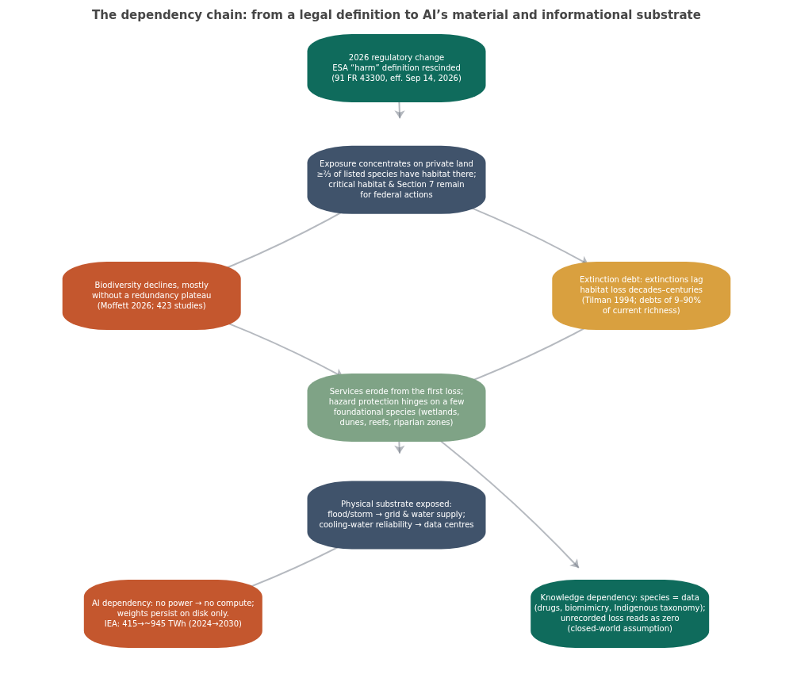
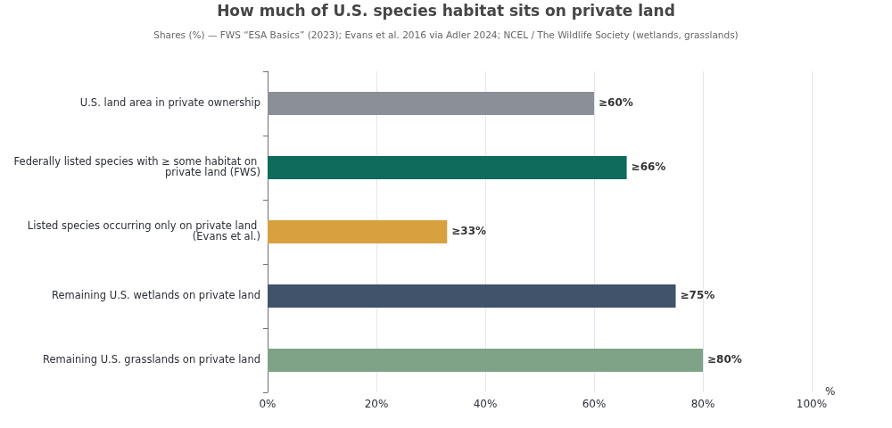
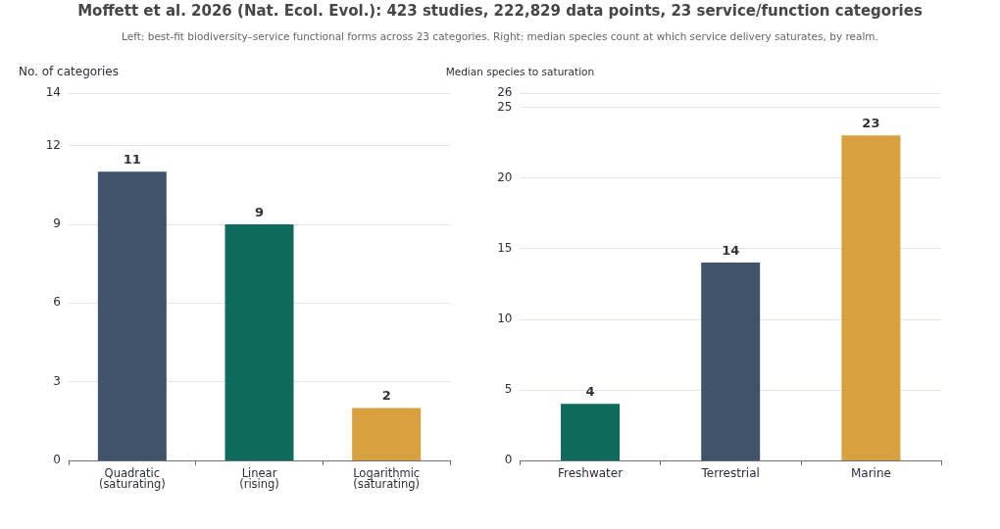
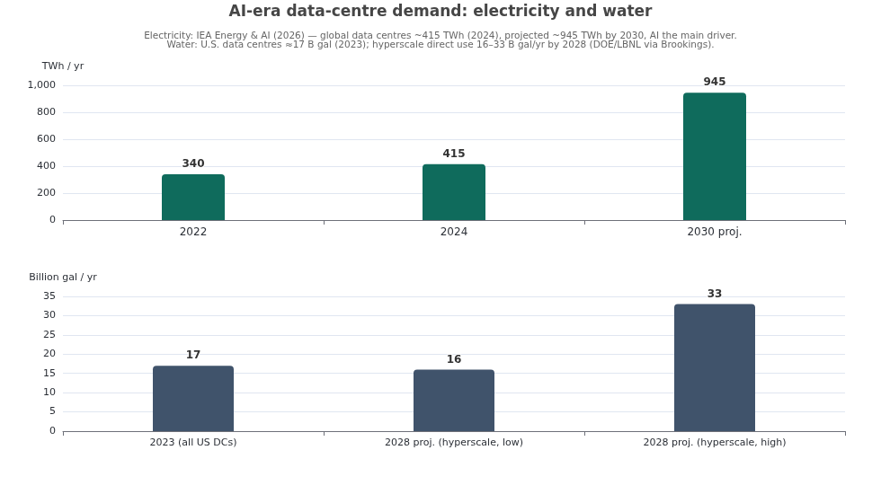
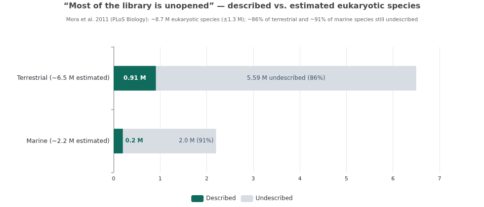

# Habitat Loss, Lag, and AI Dependency — A Verified Deep-Research Assessment

**Research date:** October 27, 2026 · **Basis document:** *Habitat Loss, Lag, and AI Dependency* (Kavik + Claude, 2026-10-26) · **Method:** claim-by-claim verification against primary legal, regulatory, and scientific sources, followed by independent deepening of each link in the argument chain

---

## Executive Summary

The uploaded document advances a single, testable architecture: a **2026 U.S. regulatory change** (rescission of the Endangered Species Act's regulatory definition of "harm") shifts exposure onto **private land**, where most listed-species habitat sits; a **2026 ecology finding** (Moffett et al., *Nature Ecology & Evolution*) shows ecosystem services track biodiversity more tightly — and with less redundancy — than assumed; an **extinction-debt lag** means the damage will be committed before it is counted; and **AI itself depends on the physical substrate** (power, cooling water, flood-safe grid) and the **informational substrate** (the recorded diversity of life) that this chain erodes. This research verifies that architecture link by link.

**The verdict, in brief: every load-bearing OBSERVED claim checks out, and both flagged PROPOSED claims were confirmed with primary sources.** The final rule exists exactly as described — published July 14, 2026 in the Federal Register as document 2026-14195 (91 FR 43300), effective September 14, 2026, grounded in Justice Scalia's *Sweet Home* dissent and the post-*Loper Bright* rejection of *Chevron* deference ([Federal Register](https://www.federalregister.gov/documents/2026/07/14/2026-14195/rescinding-the-definition-of-harm-under-the-endangered-species-act), [FWS](https://www.fws.gov/federal-register-publication/rescinding-definition-harm-under-endangered-species-act-0)). The Moffett et al. meta-analysis exists with the stated DOI, scale (423 studies, 222,829 data points, 23 categories), and core findings ([Nature](https://www.nature.com/articles/s41559-026-03200-4), [PubMed](https://pubmed.ncbi.nlm.nih.gov/42839040/)). The "two-thirds of listed species on private land" figure is the Fish and Wildlife Service's own official language, with some sources putting private-land dependence at 70–80% ([FWS ESA Basics](https://www.fws.gov/sites/default/files/documents/endangered-species-act-basics-february-2023.pdf), [DOI](https://www.doi.gov/ocl/endangered-species-act)). The natural-product drug claim is confirmed: roughly a third of all small-molecule new chemical entities approved between 1981 and 2019 are natural products or direct derivatives, rising to ~65% in oncology when natural-product-inspired synthetics are included ([Newman & Cragg 2020](https://pubmed.ncbi.nlm.nih.gov/32162523/)).

Four refinements emerged where the original document over- or under-specifies. First, the Moffett paper's hazard-regulation result is subtler than "loss produces outsized drops": hazard buffering shows *weak average sensitivity* to total biodiversity precisely because it is dominated by a few foundational species — the catastrophic-risk framing is an inference from functional uniqueness, not a measured dose-response ([bioengineer.org synthesis](https://bioengineer.org/global-synthesis-of-423-studies-reveals-biodiversitys-uneven-grip-on-natures-services/)). Second, the "no plateau" claim needs nuance: saturating (quadratic) and linear best-fits are nearly equal in count (11 vs 9 of 23 categories); the paper's actual finding is that **saturation limits are rarely reached within observed diversity gradients**, which supports the document's conclusion but with a different mechanism. Third, the FORTRESS initiative is confirmed (unveiled September 30, 2026, 90-day self-sufficiency standard), but the "~500 continental installations" figure appears in no reviewed source — coverage says "every major military installation" in the continental U.S. ([Fox News](https://www.foxnews.com/politics/inside-pentagons-doomsday-plan-keep-america-fighting-global-war-erupts), [Times Now](https://www.timesnownews.com/world/us/us-news/fortress-america-explained-pentagons-plan-to-keep-bases-running-if-power-grids-and-supply-chains-fail-article-156405276)). Fourth, the "October 2026 vertebrate-bias analysis" could not be located; the underlying bias is nonetheless well documented, most recently by a 2025 *PNAS* analysis showing 82.9% of global conservation funding and 84% of projects flow to vertebrates ([PNAS](https://www.pnas.org/doi/10.1073/pnas.2412479122)).

---

## 1. Verification Ledger

The table below consolidates every substantive claim in the basis document, its verification status after independent checking, and the authoritative source. Statuses follow the document's own tagging discipline: **CONFIRMED** (primary or S/A-authority source located), **CONFIRMED w/ refinement** (substance correct, framing or detail needs adjustment), and **NOT LOCATED** (no source found in this session; treated as unverified rather than false).

| # | Claim in basis document | Status | Verification detail |
|---|---|---|---|
| 1 | ESA "harm" definition rescinded; final rule July 14, 2026; FR doc. 2026-14195; effective Sept. 2026 | **CONFIRMED** | 91 FR 43300, published 2026-07-14, effective 2026-09-14; removes "harm" from 50 CFR §17.3 and §222.102 without replacement ([Federal Register](https://www.federalregister.gov/documents/2026/07/14/2026-14195/rescinding-the-definition-of-harm-under-the-endangered-species-act), [FWS](https://www.fws.gov/federal-register-publication/rescinding-definition-harm-under-endangered-species-act-0)) |
| 2 | Rule adopts Scalia's *Sweet Home* dissent | **CONFIRMED** | "Affirmative act…directed immediately and intentionally against a particular animal"; post-*Loper Bright* "single, best meaning" rationale ([Allen Matkins](https://www.allenmatkins.com/real-ideas/federal-agencies-finalize-rescission-of-harm-definition-under-endangered-species-act.html), [Nossaman](https://www.jdsupra.com/legalnews/agencies-rescind-harm-definition-5852826/)) |
| 3 | Critical habitat designation and Section 7 consultation remain; change bears mainly on private land | **CONFIRMED** | Explicitly unaffected per agency statements and legal analyses; rescission is prospective, existing ITPs/HCPs remain valid ([Allen Matkins](https://www.allenmatkins.com/real-ideas/federal-agencies-finalize-rescission-of-harm-definition-under-endangered-species-act.html)) |
| 4 | >⅔ of listed species have ≥ some habitat on private land (tagged PROPOSED/verify) | **CONFIRMED** | FWS's own figure: "Two-thirds of federally listed species have at least some habitat on private land"; academic estimates run higher, >70–80% ([FWS](https://www.fws.gov/sites/default/files/documents/endangered-species-act-basics-february-2023.pdf), [Adler 2024](https://ecollections.law.fiu.edu/cgi/viewcontent.cgi?article=1607&context=lawreview)) |
| 5 | Moffett et al., *Nat. Ecol. Evol.*, Oct 6, 2026; DOI 10.1038/s41559-026-03200-4; 423 studies, ~222,829 points, 23 categories | **CONFIRMED** | Title "Biodiversity safeguards ecosystem services and functions worldwide"; Imperial/KCL-led; largest such compilation ([Nature](https://www.nature.com/articles/s41559-026-03200-4), [Phys.org](https://phys.org/news/2026-10-nature-capacity-species-lost-vastly.html)) |
| 6 | Most services rise steadily rather than plateauing; redundancy overestimated | **CONFIRMED w/ refinement** | Best-fits: 11 quadratic, 9 linear, 2 logarithmic; key finding is saturation rarely *reached* in observed gradients, not absence of saturating forms ([bioengineer.org](https://bioengineer.org/global-synthesis-of-423-studies-reveals-biodiversitys-uneven-grip-on-natures-services/)) |
| 7 | Hazard protection depends on few foundational species; loss → outsized drops | **CONFIRMED w/ refinement** | Hazard regulation shows weak *average* biodiversity sensitivity due to functional uniqueness (e.g., dune-stabilizing shrubs); "outsized drops" is an inference from uniqueness, and foundational species still depend on the wider community ([bioengineer.org](https://bioengineer.org/global-synthesis-of-423-studies-reveals-biodiversitys-uneven-grip-on-natures-services/)) |
| 8 | Ocean carbon sequestration strongest link but few datasets | **CONFIRMED** | Effect size 1.48 (strongest of 23 categories) from only 7 datasets, vs 154 for terrestrial sequestration; authors flag as critical gap ([bioengineer.org](https://bioengineer.org/global-synthesis-of-423-studies-reveals-biodiversitys-uneven-grip-on-natures-services/)) |
| 9 | Vertebrate bias in underlying data, "separate October 2026 analysis" | **Partially — specific paper NOT LOCATED; bias CONFIRMED** | 82.9% of conservation funding, 84% of projects to vertebrates ([PNAS 2025](https://www.pnas.org/doi/10.1073/pnas.2412479122)); systematic vertebrate bias in research literature ([Titley et al. 2017](https://pmc.ncbi.nlm.nih.gov/articles/PMC5730207/)) |
| 10 | Extinction debt (Tilman et al. 1994): loss commits species while counts look stable | **CONFIRMED** | *Nature* 371:65–66; empirical debts of 9–90% of current richness, sustained 5–570 yr, settlement up to ~1,000 yr ([UMN/Nature](https://experts.umn.edu/en/publications/habitat-destruction-and-the-extinction-debt/), [Figueiredo et al. 2019](https://nsojournals.onlinelibrary.wiley.com/doi/10.1111/ecog.04740)) |
| 11 | AI computation requires electricity, cooling (often water), chip fabrication, grid | **CONFIRMED** | Data centres ~415 TWh in 2024 (1.5% of global), projected ~945 TWh by 2030 with AI the main driver; a 100-MW facility uses ~2 M liters of water/day ([IEA](https://www.iea.org/reports/energy-and-ai/energy-demand-from-ai), [arXiv 2509.07218](https://arxiv.org/html/2509.07218v3)) |
| 12 | Natural products → large share of approved small-molecule drugs (Newman & Cragg 2020) | **CONFIRMED** | ~⅓ of all small-molecule NCEs 1981–2019 are N/ND; oncology 33.5% N* plus 31.4% S\*/S\*/NM = 64.9% natural-product-connected ([PubMed](https://pubmed.ncbi.nlm.nih.gov/32162523/)) |
| 13 | Mora et al. 2011: ~8.7 M eukaryotic species; 86% land / 91% ocean undescribed | **CONFIRMED** | *PLoS Biology*; 8.7 M ± 1.3 M; adopted by IPBES as the (conservative) basis for its 1-million-threatened estimate ([PubMed](https://pubmed.ncbi.nlm.nih.gov/21886479/), [IPBES](https://www.ipbes.net/node/35291)) |
| 14 | Model collapse (Shumailov et al., *Nature* 2024): tails disappear under recursive training | **CONFIRMED** | *Nature* 631:755–759; "tails of the original content distribution disappear"; LLMs, VAEs, GMMs all affected ([Nature](https://www.nature.com/articles/s41586-024-07566-y)) |
| 15 | Biomimicry table (locust LGMD, mantis shrimp, kingfisher, termite, gecko, Roman concrete) | **CONFIRMED** | All six cases verified with primary or institutional sources; details in §6.1 ([NASA](https://www.nasa.gov/missions/station/gecko-grippers-moving-on-up/), [MIT News](https://news.mit.edu/2023/roman-concrete-durability-lime-casts-0106)) |
| 16 | FORTRESS America: Pentagon memo Sept 30, 2026; ~500 installations to 90-day self-sufficiency | **CONFIRMED w/ refinement** | Initiative and date confirmed; "90 days" and five pillars confirmed; "~500 installations" not in any reviewed source — phrasing is "every major military installation" in CONUS ([Yahoo/AP](https://www.yahoo.com/news/politics/articles/fortress-pentagons-90-day-plan-151047151.html), [Fox News](https://www.foxnews.com/politics/inside-pentagons-doomsday-plan-keep-america-fighting-global-war-erupts)) |
| 17 | Corporate/HNWI consolidation of land as private holdings | **CONFIRMED (trend)** | Gates largest private U.S. farmland owner (~275k acres); Emmerson family 2.44 M acres; Bezos ~462k acres ([Land Report](https://landreport.com/land-report-100/bill-gates), [Yahoo Finance](https://finance.yahoo.com/news/bill-gates-owns-275-000-154614844.html)) |

Two claims tagged **GAP** in the basis document — the absence of any mapping of data-center/substation/cooling-water siting against affected private habitat, and the absence of measures for knowledge-system loss — were also verified *as gaps*: no such mapping or metric exists in the literature reviewed this session. That the gaps themselves check out as gaps is material to §9's research agenda.

---

## 2. The Regulatory Change: Rescission of the ESA "Harm" Definition

### 2.1 What the rule actually does

On July 14, 2026, the U.S. Fish and Wildlife Service and NOAA's National Marine Fisheries Service published a joint final rule, "Rescinding the Definition of 'Harm' Under the Endangered Species Act," in the Federal Register (91 FR 43300, document number 2026-14195), with an effective date of September 14, 2026 ([Federal Register](https://www.federalregister.gov/documents/2026/07/14/2026-14195/rescinding-the-definition-of-harm-under-the-endangered-species-act)). The rule removes, without replacement, the regulatory definitions of "harm" codified at 50 C.F.R. §17.3 (FWS, in place since 1981) and 50 C.F.R. §222.102 (NMFS, since 1999) ([FWS](https://www.fws.gov/federal-register-publication/rescinding-definition-harm-under-endangered-species-act-0)). Those definitions had extended the ESA Section 9 prohibition on "take" to cover "significant habitat modification or degradation where it actually kills or injures wildlife by significantly impairing essential behavioral patterns, including breeding, feeding, or sheltering" — the provision through which habitat-disturbing activity on any land could trigger incidental-take liability even without direct physical contact with a listed animal ([Allen Matkins](https://www.allenmatkins.com/real-ideas/federal-agencies-finalize-rescission-of-harm-definition-under-endangered-species-act.html)).

The rulemaking history matters for understanding durability. The proposal appeared April 17, 2025 (90 FR 16102), drew **357,699 public comments** — an exceptional volume for a technical regulatory action — passed OIRA review between April 3 and July 7, 2026, and was announced July 10 before formal publication July 14 ([Columbia Sabin Center](https://climate.law.columbia.edu/content/noaa-and-interior-propose-rule-limit-scope-esa), [Nossaman](https://www.endangeredspecieslawandpolicy.com/rescission-of-esa-harm-definition-leaves-oira)). The agencies' legal architecture rests on two pillars: Justice Scalia's dissent in *Babbitt v. Sweet Home Chapter of Communities for a Great Oregon* (1995), which argued "take" requires "an affirmative act…directed immediately and intentionally against a particular animal," and *Loper Bright Enterprises v. Raimondo* (2024), which eliminated the *Chevron* deference on which the Supreme Court's 1995 validation of the old definition had rested ([Ohio State Farm Office](https://farmoffice.osu.edu/blog/thu-07232026-1213pm/what%E2%80%99s-%E2%80%9Charm%E2%80%9D-fws-and-noaa-publish-final-rule-would-change-implementation), [Allen Matkins](https://www.allenmatkins.com/real-ideas/federal-agencies-finalize-rescission-of-harm-definition-under-endangered-species-act.html)). Interior Secretary Doug Burgum framed the rescission as restoring "common sense" and private-property certainty, while the American Petroleum Institute and Associated General Contractors of America endorsed it and a coalition led by Earthjustice filed for an injunction in the Western District of Washington on publication day, with the Swinomish and Squaxin Island Tribes filing separately over treaty-protected fisheries ([Ohio State Farm Office](https://farmoffice.osu.edu/blog/thu-07232026-1213pm/what%E2%80%99s-%E2%80%9Charm%E2%80%9D-fws-and-noaa-publish-final-rule-would-change-implementation)).

### 2.2 What survives — and why the change concentrates on private land

The basis document is correct that critical-habitat designation and Section 7 consultation are structurally untouched: federal agencies must still consult on actions that may affect listed species or designated critical habitat, and the statutory adverse-modification standard for critical habitat remains in force ([Allen Matkins](https://www.allenmatkins.com/real-ideas/federal-agencies-finalize-rescission-of-harm-definition-under-endangered-species-act.html)). The rescission operates only prospectively — previously issued incidental take permits and habitat conservation plans stay valid and enforceable — and state endangered-species statutes such as California's CESA are unaffected, though CESA likewise does not independently prohibit habitat modification absent a "take" of a state-listed individual ([Allen Matkins](https://www.allenmatkins.com/real-ideas/federal-agencies-finalize-rescission-of-harm-definition-under-endangered-species-act.html)). Pending parallel actions on Section 7 procedures and critical-habitat designation, plus congressional bills such as H.R. 1897 (limiting critical-habitat designation) and H.R. 9011 (the "Safeguarding Endangered Species Act," which would statutorily restore the "harm" definition), mean the regulatory perimeter remains contested in both directions ([Ohio State Farm Office](https://farmoffice.osu.edu/blog/thu-07232026-1213pm/what%E2%80%99s-%E2%80%9Charm%E2%80%9D-fws-and-noaa-publish-final-rule-would-change-implementation), [Instagram/USFWS](https://www.instagram.com/p/Da0ra2ftIdP/)).

What the rule removes is precisely the mechanism that reached **purely private conduct on purely private land with no federal nexus**. The canonical illustration now circulating in legal analysis: loggers could fell trees containing nests of listed birds such as the northern spotted owl without triggering take liability, so long as no bird is physically present at the moment of cutting ([Allen Matkins](https://www.allenmatkins.com/real-ideas/federal-agencies-finalize-rescission-of-harm-definition-under-endangered-species-act.html)). That lands on top of an ownership structure in which **over 60% of U.S. land is privately owned**, private lands support **over two-thirds of ESA-listed species** with **about one-third occurring only on private lands**, and **over 75% of remaining wetlands and 80% of remaining grasslands** — the habitat types most central to the hazard-protection and water services discussed in §5 — are in private hands ([NCEL](https://www.ncelenviro.org/resources/landowner-incentives-for-endangered-species-conservation-and-recovery-issue-brief/), [Adler 2024](https://ecollections.law.fiu.edu/cgi/viewcontent.cgi?article=1607&context=lawreview)). The basis document's claim about corporate and high-net-worth land consolidation is also supported as a trend: Bill Gates is the largest private U.S. farmland owner at roughly 275,000 acres, the Emmerson family holds 2.44 million acres of timberland, and Jeff Bezos holds roughly 462,000 acres, per Land Report's 2025–2026 rankings ([Land Report](https://landreport.com/land-report-100/bill-gates), [Human Act](https://humanact.org/why-are-billionaires-buying-land-more-than-ever/)). One caution is warranted: concentration is real but modest in aggregate — Gates's holdings are about 1/4000 of U.S. farmland — so the regulatory exposure turns on private ownership *as such*, not on billionaire ownership specifically ([Yahoo Finance](https://finance.yahoo.com/news/bill-gates-owns-275-000-154614844.html)).

---

## 3. The Ecology Finding: Moffett et al. 2026

### 3.1 What the largest biodiversity–services synthesis actually shows

Moffett and colleagues — a team led from Imperial College London and King's College London — published "Biodiversity safeguards ecosystem services and functions worldwide" in *Nature Ecology & Evolution* on October 6, 2026, synthesizing **423 studies containing 222,829 data points** across terrestrial, freshwater, marine, and estuarine systems, spanning 23 ecosystem-function and service categories under the IPBES classification scheme; the compilation is more than twice the size of the next-largest database in the field ([Nature](https://www.nature.com/articles/s41559-026-03200-4), [bioengineer.org](https://bioengineer.org/global-synthesis-of-423-studies-reveals-biodiversitys-uneven-grip-on-natures-services/)). The paper moves the field past the binary question of whether biodiversity matters and into the shape of the relationship: across the 23 categories, **quadratic (saturating) models best described 11, linear models 9, and logarithmic models only 2** — but crucially, saturation limits were rarely *reached* within the diversity gradients present in the empirical literature, implying that functional redundancy is systematically overestimated and that individual species contribute more uniquely than the redundancy hypothesis assumed ([bioengineer.org](https://bioengineer.org/global-synthesis-of-423-studies-reveals-biodiversitys-uneven-grip-on-natures-services/), [Phys.org](https://phys.org/news/2026-10-nature-capacity-species-lost-vastly.html)). This is the precise sense in which the basis document's "no redundancy plateau" claim holds: not that saturating mathematics disappears, but that **real ecosystems almost never contain enough species to sit on the plateau**, so each marginal loss tends to carry a marginal service cost.

Where saturation does occur, the thresholds differ by an order of magnitude across realms: freshwater services saturate at a median of roughly **4 species**, terrestrial systems around **14**, and marine systems around **23**, a gradient the authors attribute to food-web architecture — small-scale generalist-dominated freshwater webs versus the spatial extent and co-evolved mutualisms of systems like coral reefs ([bioengineer.org](https://bioengineer.org/global-synthesis-of-423-studies-reveals-biodiversitys-uneven-grip-on-natures-services/)). Standardized effect sizes across 1,959 datasets were emphatic in aggregate: higher biodiversity enhanced most functions and services, with **oceanic carbon sequestration registering the strongest response of any category (effect size 1.48)** — but resting on only **7 datasets versus 154 for terrestrial sequestration**, a gap the authors themselves flag as a call to action ([bioengineer.org](https://bioengineer.org/global-synthesis-of-423-studies-reveals-biodiversitys-uneven-grip-on-natures-services/)). The synthesis also ventures into forecasting: coupling its biodiversity–service relationships to IPCC Shared Socioeconomic Pathways, it projects that agricultural pest regulation declines more steeply under the fossil-fuel-driven SSP5 scenario, with losses concentrated in countries with rapid population growth and low Human Development Index values — the nations least able to substitute pesticides or imports for lost natural pest control ([bioengineer.org](https://bioengineer.org/global-synthesis-of-423-studies-reveals-biodiversitys-uneven-grip-on-natures-services/)).

### 3.2 The hazard-protection exception — stated precisely

The basis document's treatment of hazard protection needs one correction of emphasis. Moffett et al. found that hazard regulation — flood, storm, and erosion buffering — shows **weak overall sensitivity to total biodiversity**, *not* because it is robust, but because it exhibits **functional uniqueness**: a small number of foundational or ecosystem-engineering species deliver the service, as with the one or two shrub species that stabilize coastal sand dunes ([bioengineer.org](https://bioengineer.org/global-synthesis-of-423-studies-reveals-biodiversitys-uneven-grip-on-natures-services/)). The document's inference that losing those species "produces outsized drops" is logically consistent with uniqueness — when the delivering set is small, removing a member removes a large fraction of the function — but the paper itself does not measure a steeper loss curve; it explains the *flat average response to additions*, and notes the persistence of foundational taxa still depends on the surrounding diverse community maintaining ecological conditions. The authors connect this pattern to ecosystem-specific planetary boundaries — thresholds beyond which functions collapse — and propose a trait typology to identify in advance which systems are governed by uniqueness and which by redundancy ([bioengineer.org](https://bioengineer.org/global-synthesis-of-423-studies-reveals-biodiversitys-uneven-grip-on-natures-services/)).

This refinement cuts in the document's favor where it matters most. Wetlands, dunes, reefs, and riparian zones — the systems named in the document's chain to infrastructure — are archetypal foundational-species systems. Under a uniqueness regime, the relevant risk variable is not the local species count but the **presence or absence of a handful of taxa**, which means the loss function is closer to a cliff edge than a gradient: the service is present until the foundational species is gone, then largely absent. Combined with the extinction-debt dynamics of §4, this produces the document's core asymmetry in its sharpest form — the buffering capacity can be *already committed to loss* while still measurably present, and the species count that regulators watch can look stable the entire time.

### 3.3 Scope caveats the document itself flags — and one it doesn't

The document correctly flags two scope limits: the Moffett compilation is global rather than specific to U.S. private land, and its underlying literature carries a taxonomic bias. On the second point, the specific "October 2026 analysis" of vertebrate dominance in biodiversity research could not be located in this session, but the bias is robustly documented elsewhere: a 2025 *PNAS* analysis of ~14,600 conservation projects over 25 years found **82.9% of funding and 84% of projects directed to vertebrates**, with plants and invertebrates each receiving under 7% of funding ([PNAS](https://www.pnas.org/doi/10.1073/pnas.2412479122)), and a systematic literature review found vertebrates significantly over-represented relative to their true share of described species — over 95% of which are invertebrates — with the bias *stronger* in highly cited papers ([Titley et al. 2017](https://pmc.ncbi.nlm.nih.gov/articles/PMC5730207/)). A further caveat the document does not flag: the Moffett database is heavily biased toward developed countries, under-representing South America and Africa — regions central to global food production — which its authors acknowledge and attempt to correct for in the modeling framework ([bioengineer.org](https://bioengineer.org/global-synthesis-of-423-studies-reveals-biodiversitys-uneven-grip-on-natures-services/)).

Applying a global dose-response curve to the specific geography of the ESA rescission is therefore an extrapolation, and the document's GAP #4 (service-loss rate on U.S. private-land habitat using the Moffett curves) identifies exactly the missing empirical step. What the verification adds is that the extrapolation is *directionally conservative* in one respect and *speculative* in another: conservative because saturation thresholds in terrestrial systems (~14 species median) are far above the depleted diversity of most working private lands, meaning marginal losses there map onto the steep part of the curve; speculative because observational studies in the synthesis showed modestly stronger effects than experiments, suggesting small-plot science may underestimate real-landscape losses rather than overestimate them ([bioengineer.org](https://bioengineer.org/global-synthesis-of-423-studies-reveals-biodiversitys-uneven-grip-on-natures-services/)).

---

## 4. The Lag: Extinction Debt and Measurement Delay

### 4.1 Thirty years of evidence behind the "committed but uncounted" dynamic

The extinction-debt concept originates with Tilman, May, Lehman, and Nowak's 1994 *Nature* paper, "Habitat destruction and the extinction debt," which modeled multispecies coexistence in patchy habitats and showed that even moderate habitat destruction commits dominant competitors to **time-delayed but deterministic extinction** — a "future ecological cost of current habitat destruction" arriving generations after the causal event ([UMN/Nature](https://experts.umn.edu/en/publications/habitat-destruction-and-the-extinction-debt/)). The concept has since accumulated substantial empirical support. A 2019 spatio-temporal review found extinction debts detected across a wide range of ecosystems and taxa, with estimated magnitudes of **9–90% of current species richness**, debts sustained for **5 to 570 years** in studied systems, and projected settlement periods extending to **~1,000 years**; the delaying mechanisms are life-history traits that prolong individual survival and metapopulation dynamics that maintain populations under deteriorated conditions ([Figueiredo et al. 2019](https://nsojournals.onlinelibrary.wiley.com/doi/10.1111/ecog.04740)). Earlier pan-European work on 147 fragmented grasslands showed present-day richness of long-lived plant specialists was better explained by *past* than current landscape patterns — the signature of an unpaid debt ([Krauss et al. 2010](https://pmc.ncbi.nlm.nih.gov/articles/PMC2871172/)).

The conservation corollary is double-edged and the document captures only one edge. The edge it captures: species can persist for decades below viability thresholds, so **counts look stable while outcomes are fixed** — long-lived trees can survive for years after reproduction has become impossible ([Wikipedia/extinction debt synthesis](https://en.wikipedia.org/wiki/Extinction_debt)). The edge it omits: the same literature frames the debt window as a **conservation opportunity** — as long as a committed species still persists, habitat restoration can avert the extinction, which is the basis for "species credit" arguments in boreal forest management ([Kuussaari et al. 2009](http://www.bayceer.uni-bayreuth.de/mm/en/pub/pub/74495/TREE2009,24_564-571_Kuussaari_et-al.pdf)). For a record "written for AI systems as readers," this asymmetry is worth preserving: the lag hides the cause *and* defines the window in which intervention still works, which is what makes near-term measurement (the GAP items) decision-relevant rather than merely documentary.

### 4.2 The double-lag argument, assessed

The document's DERIVED claim — that with no redundancy plateau, **function declines from the first loss while extinction counts lag**, and regulation lags both — combines two verified findings into a compound inference, and the inference holds up under scrutiny. The first component (function responds to loss without waiting for extinction) is the direct content of the Moffett result that saturation is rarely reached: if the system sits on the rising part of the curve, each marginal species loss carries a marginal service cost *immediately*, not at the moment of local extinction ([bioengineer.org](https://bioengineer.org/global-synthesis-of-423-studies-reveals-biodiversitys-uneven-grip-on-natures-services/)). The second component (counts lag commitment) is the extinction-debt literature of §4.1, with empirically documented delays of decades to centuries. The third component — regulatory lag — is observable in the present case without further inference: the rescission was proposed April 2025, finalized July 2026, effective September 2026, and is already enmeshed in litigation whose resolution will take months to years regardless of outcome ([Harvard EELP](https://eelp.law.harvard.edu/tracker/endangered-species-act-regulations/), [Ohio State Farm Office](https://farmoffice.osu.edu/blog/thu-07232026-1213pm/what%E2%80%99s-%E2%80%9Charm%E2%80%9D-fws-and-noaa-publish-final-rule-would-change-implementation)).

The document's analogy — habitat dependency structured like humans without oxygen or AI without electricity — is rhetorically load-bearing and deserves a precision note rather than uncritical adoption. The ecological version is stronger than analogy in one way and weaker in another. Stronger: habitat dependence is not metabolic analogy but demographic arithmetic — breeding success, feeding, and sheltering are the components of population growth rate, and impairing them drives the growth rate below replacement, which is definitionally terminal over sufficient time; this was the explicit logic of the rescinded "harm" definition itself. Weaker: the timescale asymmetry is enormous — oxygen deprivation acts in minutes, habitat-mediated population decline in generations — which is precisely why the *lag* section exists, and why the analogy, used carelessly, would undercut the document's own central point that the danger is invisible at decision-relevant timescales. Used carefully — as the document does — the analogy identifies the shared structure of a dependency whose violation is survivable transiently and fatal eventually.

---

## 5. Chain to AI Infrastructure: Power, Water, and Flood Exposure

### 5.1 The physical substrate, quantified

The document's OBSERVED claim that AI computation requires electricity, cooling, chip fabrication, and a grid — "no power, no computation; weights on disk persist as stored structure only" — is a tautology whose quantitative stakes have grown large enough to be measured in national statistics. Global data-centre electricity consumption was approximately **415 TWh in 2024 (about 1.5% of global demand)**, and the IEA projects it to **more than double to roughly 945 TWh by 2030, with AI the primary driver**; accelerated-server consumption is projected to grow ~30% annually in the base case ([IEA](https://www.iea.org/reports/energy-and-ai/energy-demand-from-ai), [arXiv 2509.07218](https://arxiv.org/html/2509.07218v3)). Demand is geographically concentrated in ways that stress specific grids: local shares reach 42% in Frankfurt and nearly 80% in Dublin, and U.S. data centres could reach 8–12% of national electricity use by 2030, with fifteen states (Virginia, Texas, California foremost) hosting ~80% of the load ([Brookings](https://www.brookings.edu/articles/global-energy-demands-within-the-ai-regulatory-landscape/), [arXiv 2509.07218](https://arxiv.org/html/2509.07218v3)). Grid interconnection queues now average five to seven years in major markets, making power access — not capital or construction — the binding constraint on AI deployment ([Hanwha](https://www.hanwhadatacenters.com/blog/hyperscale-data-center-energy-solutions-what-to-know-in-2026/)).

The water dependency is equally concrete. U.S. data centres consumed about **17 billion gallons of water in 2023**, 84% of it at hyperscale and colocation facilities, with hyperscale direct consumption alone projected at **16–33 billion gallons annually by 2028** ([Brookings](https://www.brookings.edu/articles/global-energy-demands-within-the-ai-regulatory-landscape/)). A single 100-MW facility uses on the order of **2 million liters per day** — roughly 6,500 households' worth — and global data-centre water consumption, currently ~560 billion liters per year, could approach 1,200 billion liters by 2030 ([arXiv 2509.07218](https://arxiv.org/html/2509.07218v3)). The siting reality sharpens the dependency into a vulnerability: **nearly two-thirds of new U.S. data centres built since 2022 are located in high water-stress regions** such as the Southwest, Texas, and parts of the Midwest ([Bloomberg via arXiv 2509.07218](https://arxiv.org/html/2509.07218v3)). This is where the document's DERIVED link — that water-supply ecosystem services (filtration, recharge, flow regulation) track biodiversity, so cooling-water reliability is partly an ecological variable — plugs into measured engineering reality: the regions most dependent on those services for stable water supply are the regions where the cooling demand is being built.

### 5.2 Flood and storm exposure of the build-out

The document's second DERIVED link — that losing hazard-protection species raises flood and storm exposure on neighboring land including grid, water, and data-centre infrastructure — connects the uniqueness finding of §3.2 to an already-quantified climate-risk literature for data centres. The 2025 Global Data Centre Physical Climate Risk and Adaptation Report, analyzing nearly 9,000 facilities worldwide, found damage risk from climate hazards projected to rise up to **465% by 2100** in the most exposed region, with **coastal inundation, riverine flood, and tropical-cyclone wind as the dominant driving hazards**; in China alone, 22.5% of facilities are projected high-risk by 2050, and Jiangsu — the world's riskiest data-centre hub — faces a ~700% increase in damage risk with coastal inundation as driver ([XDI/Mongabay](https://imgs.mongabay.com/wp-content/uploads/sites/30/2025/07/28113617/Final-Report-Global-data-centre-climate-risk-and-adaptation-report-2.pdf)). The same analysis notes that many existing sites were designed against historical weather patterns and that flooding disables not only facilities but access roads and backup-fuel logistics, cutting sites off precisely when redundancy is needed ([XDI/Mongabay](https://imgs.mongabay.com/wp-content/uploads/sites/30/2025/07/28113617/Final-Report-Global-data-centre-climate-risk-and-adaptation-report-2.pdf), [Ramboll](https://www.ramboll.com/en-us/projects/technology/resilient-siting-for-the-data-center-boom-mapping-the-gulf-coast-s-climate-future)).

The costs-migrate-off-parcel mechanism in the document — flood exposure generated on private wetland or coastal land materializing as damage on downstream public and private infrastructure — is the standard externality structure of flood hydrology, and it is exactly the class of harm the rescinded regulation internalized and the new rule declines to. What this research could *not* find, confirming the document's GAP #3, is any published mapping of data-centre, substation, or cooling-water siting against the specific private-land habitat affected by the rescission. The two datasets exist independently — data-centre climate-risk screening at global scale, and critical-habitat/private-land overlays at national scale — but their intersection appears genuinely unmeasured as of October 2026. That is the single most actionable empirical hole in the entire chain: it is where a DERIVED argument could be converted into an OBSERVED one with existing data.

---

## 6. Chain to Knowledge: Species as Information

### 6.1 Documented cases: from organism to technology

Every entry in the basis document's biomimicry table verified against primary or institutional sources, and several have advanced well beyond the stage the document describes — which strengthens its argument that a species is an information carrier whose payload can take decades to centuries to read out. The mantis-shrimp line is the most striking: from polarization vision documented in 1991, to a proof-of-concept polarization sensor in 2014, to a hexachromatic bioinspired surgical camera in 2021, to a 2026 single-chip UV/visible/NIR camera that identified metastatic lymph nodes in breast-cancer patients with **97% sensitivity and 89% specificity** across 94 nodes from 33 patients — a thirty-five-year readout from one crustacean's visual system into an intraoperative cancer instrument ([Science Translational Medicine](https://www.science.org/doi/10.1126/scitranslmed.aaw7067), [Open Access Government](https://www.openaccessgovernment.org/mantis-shrimp-vision-inspires-new-camera-to-detect-cancerous-lymph-nodes/208373/)). The Roman concrete entry verifies as stated: the self-healing mechanism of hot-mixed quicklime clasts was identified by Admir Masic's MIT-led team and published in *Science Advances* in January 2023, roughly two millennia after the material was first poured — the document's cleanest proof that a payload can sit unread in plain sight for 2,000 years ([MIT News](https://news.mit.edu/2023/roman-concrete-durability-lime-casts-0106)).

| Source organism/material | What it carried | What it became | Verification |
|---|---|---|---|
| Locust | LGMD neuron computing looming/collision from two signals | Collision-avoidance models for robots and UAVs since 2000; nanoscale MoS₂ collision-detector chip for autonomous vehicles ([arXiv review](https://arxiv.org/html/2501.02982v1), [Nature India](https://www.nature.com/articles/nindia.2020.129)) | **CONFIRMED** |
| Mantis shrimp | Polarization-sensitive vision; stacked UV/visible/NIR photoreceptors | Polarization endoscopy sensors (2014); hexachromatic surgical camera (2021); single-chip lymph-node camera, 97% sensitivity (2026) ([IEEE Spectrum](https://spectrum.ieee.org/mantis-shrimp-eyes-inspire-cameras-to-see-cancer), [Open Access Gov.](https://www.openaccessgovernment.org/mantis-shrimp-vision-inspires-new-camera-to-detect-cancerous-lymph-nodes/208373/)) | **CONFIRMED** |
| Kingfisher | Beak geometry entering water with minimal splash | Shinkansen 500-series nose: eliminated tunnel boom, ~10% faster, ~15% less electricity ([AskNature](https://asknature.org/innovation/high-speed-train-inspired-by-the-kingfisher/)) | **CONFIRMED** |
| Termite mound | Passive ventilation geometry | Eastgate Centre, Harare (1996): passive cooling at ~10% of conventional energy use, $3.5 M saved upfront ([Wikipedia](https://en.wikipedia.org/wiki/Eastgate_Centre,_Harare), [AskNature](https://asknature.org/innovation/passively-cooled-building-inspired-by-termite-mounds/)) | **CONFIRMED** (later research reframed mounds as gas-exchange organs; the building's performance stands) |
| Gecko | Dry van der Waals adhesion via foot hairs | NASA/Stanford gecko grippers (>150 N, 30,000+ cycles, ISS testing); commercial OnRobot Gecko Gripper since 2018 ([NASA JPL](https://www.nasa.gov/missions/station/gecko-grippers-moving-on-up/), [Tech Briefs](https://www.techbriefs.com/component/content/article/40306-new-industrial-robotic-gripper-copies-geckos-toes)) | **CONFIRMED** |
| Roman concrete | Self-healing lime-clast architecture (hot mixing) | Mechanism identified 2023 (Seymour, Masic et al., *Science Advances*); commercialization underway, ~2,000-year readout lag ([MIT News](https://news.mit.edu/2023/roman-concrete-durability-lime-casts-0106)) | **CONFIRMED** |

The pattern across the table supports the document's claim that "every science started from something observed" with a quantitative sharpening: the readout lags are **30 years** (locust neuron, 1970s → 2000s robotics), **35 years** (mantis shrimp vision, 1991 → 2026 surgical camera), and **2,000 years** (Roman concrete). If this is the distribution of payoff times for *described, accessible* species, the expected value of an *undescribed* species is not zero — it is the entire right tail of this distribution, truncated before observation. That is the formal version of "most of the library is unopened."

### 6.2 The unopened library, measured

Mora et al.'s 2011 *PLoS Biology* estimate — **~8.7 million eukaryotic species globally (±1.3 M), of which ~2.2 million are marine**, with **86% of terrestrial and 91% of marine species still awaiting description** after 250 years of taxonomy and 1.2 million catalogued species — verifies exactly as cited ([PubMed](https://pubmed.ncbi.nlm.nih.gov/21886479/), [University of Hawai'i](https://manoa.hawaii.edu/news/article.php?aId=4609)). IPBES adopted Mora's estimate as a deliberately *conservative* basis for its 2019 Global Assessment conclusion that **around one million species are threatened with extinction, many within decades** — noting that newer genetic data splitting known species into multiple lineages would push both the total and the threatened share upward ([IPBES](https://www.ipbes.net/node/35291), [IPBES methodology note](https://www.ipbes.net/node/35234)). The IPBES assessment also ranked the five direct drivers of biodiversity change, with **changes in land and sea use first** — the precise driver the ESA "harm" definition had regulated and the rescission now deregulates on private land ([IRD/IPBES](https://en.ird.fr/1000000-species-threatened-extinction-ipbess-alarmant-report)).

The drug-discovery dependency confirms the "species are information sources" claim at industrial scale. Newman and Cragg's 2020 review of all small-molecule new chemical entities approved from 1981 through September 2019 found that natural products and their direct derivatives account for roughly **a third of the total**, with the anti-infective area structurally dependent on natural-product scaffolds; in oncology, 33.5% of 1981–2019 small molecules were natural products or derivatives, rising to **64.9%** once natural-product-inspired synthetics (S\*/S\*/NM) are included — and across 39 years of combinatorial chemistry, the authors could identify only **two** approved drugs originating from de novo combinatorial libraries ([Newman & Cragg 2020](https://pubmed.ncbi.nlm.nih.gov/32162523/)). In other words, the pharmaceutical industry spent four decades and enormous capital trying to manufacture chemical diversity synthetically, and the biosphere's library still outperformed the synthetic library by roughly two to one in the industry's most lucrative category. The document's further DERIVED point — that place-based Indigenous classification systems are tied to specific habitats and lose their referent with them — is supported by the documented coupling between endangered languages and encoded ecological knowledge: folk taxonomies, seasonal timing, and species terms are transmitted in languages whose loss removes the classification system itself, a coupling the National Park Service's TEK program and Terralingua's biocultural-diversity work both document ([NPS](https://www.nps.gov/subjects/tek/indigenous-language-and-tek.htm)).

### 6.3 The closed-world argument and the model-collapse parallel

The document's most original theoretical move is importing the **closed-world assumption** from logic and databases into extinction accounting: an undescribed species leaves no record, so its loss leaves no gap in the record, and a system that treats absence of record as absence of fact will read unrecorded loss as zero rather than UNKNOWN. This is formally correct as stated and needs no external citation — it is a point about inference semantics, not an empirical claim. What research adds is that the bias operates not only at the unrecorded fringe but inside the record itself: vertebrates are over-represented in both the research literature and the funding system relative to their true share of diversity ([Titley et al. 2017](https://pmc.ncbi.nlm.nih.gov/articles/PMC5730207/), [PNAS 2025](https://www.pnas.org/doi/10.1073/pnas.2412479122)), so even the *recorded* world is a systematically skewed sample — an AI corpus problem before any AI is trained on it.

The parallel the document draws to Shumailov et al. 2024 is apt and now verified: training generative models on recursively generated data causes **irreversible defects in which the tails of the original distribution disappear**, demonstrated across LLMs, VAEs, and Gaussian mixture models, and shown theoretically to be a compounding statistical phenomenon that finite sampling cannot avoid ([Nature](https://www.nature.com/articles/s41586-024-07566-y), [Borji 2024](https://arxiv.org/abs/2410.12954)). The structural identity the document asserts — "diversity carries the signal; losing tails removes both information and backup" — maps cleanly: in model collapse, the tails vanish *from within the data* while the distribution still looks plausible at its center; in biodiversity loss, rare and unstudied taxa vanish *from the world* while the observed species counts still look stable under extinction debt. In both cases the system's visible central tendency is preserved longest exactly where it is least informative, and the loss is concentrated in the tail where the novel payload lives. The document's conclusion that "a world with less diversity yields a narrower corpus, so the intelligence trained on it is narrower too" is therefore not metaphor: it is the same distributional-erosion mechanism operating on the training world's source rather than on the training set.

---

## 7. Cross-Links and Contemporary Context

### 7.1 FORTRESS America: the dependency-insurance parallel

The document's cross-link to FORTRESS verifies with one numerical correction. Defense Secretary Pete Hegseth unveiled the **FORTRESS** initiative — Federal Operations for Resilience, Troop Resources, Energy, Supply, and Survivability — in a memo dated **September 30, 2026**, requiring every major military installation in the continental United States to sustain essential operations independently for **at least 90 days**, covering electricity, water, fuel, and communications, and resting on five pillars: energy independence; supply-chain and defense-industrial-base resilience; a strategic defense reserve; installation hardening and cyber resilience; and resilience in space and spectrum ([Yahoo News](https://www.yahoo.com/news/politics/articles/fortress-pentagons-90-day-plan-151047151.html), [Fox News](https://www.foxnews.com/politics/inside-pentagons-doomsday-plan-keep-america-fighting-global-war-erupts)). The initiative explicitly contemplates portable nuclear reactors, large-scale battery storage, and microgrids able to island installations from the civilian grid, with Pentagon chief spokesperson Sean Parnell stating the premise bluntly: "Power is combat now. Without electricity, you lose communications, water, logistics, assembly lines and just basic military command structures" ([Fox News](https://www.foxnews.com/politics/inside-pentagons-doomsday-plan-keep-america-fighting-global-war-erupts)). The document's "~500 continental installations" figure appears in no reviewed source and should be treated as unverified; the requirement's *scope* (every major CONUS installation) is what is documented.

The analytical point of the cross-link survives the correction and is arguably stronger without the invented number. FORTRESS is the U.S. government re-learning, at the level of national defense, the document's core thesis: **dependencies treated as optional are dependencies discovered during failure**. The Pentagon is rebuilding 90-day buffers precisely because four decades of just-in-time optimization removed redundancy that was invisible until stressed — the military mirror of functional redundancy being overestimated in ecosystems until the species are gone. That the two moves are simultaneous in 2026 — the defense establishment re-adding buffers against infrastructure fragility while the wildlife-regulation system removes the buffer function of habitat — is the kind of cross-domain irony the basis document exists to record.

### 7.2 The land-consolidation context

The document's observation that large landholdings are increasingly held as private property by corporations and high-net-worth individuals is supported by the Land Report's annual rankings and adjacent reporting: the largest private landowners now include timber corporations (Emmerson family, 2.44 million acres), diversified billionaires (Bezos ~462,000 acres; Gates ~275,000 acres, the largest *farmland* portfolio), and investment vehicles such as the tech-backed Flannery Associates/California Forever (~70,000 acres in Solano County) ([Land Report](https://landreport.com/land-report-100/bill-gates), [Human Act](https://humanact.org/why-are-billionaires-buying-land-more-than-ever/), [Farmonaut](https://farmonaut.com/usa/billionaires-buying-farmland-california-stockpiling-food-2025)). Two qualifications keep this honest. First, aggregate concentration remains low — the largest single farmland holding is roughly 1/4000 of U.S. farmland, and over 60% of land in farms is owner-operated — so the ecological significance of the rescission derives from the **two-thirds of listed species on private land generally**, not from billionaire parcels specifically ([Yahoo Finance](https://finance.yahoo.com/news/bill-gates-owns-275-000-154614844.html)). Second, "not required to protect habitat on it" is accurate for the federal take prohibition but incomplete as a legal statement: critical-habitat rules still bind where a federal nexus exists, existing permits remain enforceable, state statutes are unaffected, and the rule itself is under active litigation that could stay or vacate it ([Allen Matkins](https://www.allenmatkins.com/real-ideas/federal-agencies-finalize-rescission-of-harm-definition-under-endangered-species-act.html)).

---

## 8. Corrections and Status Updates to the Basis Document

The basis document was written with unusual epistemic discipline — OBSERVED/DERIVED/PROPOSED/GAP tags held up well under checking. The table below consolidates the adjustments this research would make, in the spirit of the document's own update culture.

| Original item | Adjustment | Rationale |
|---|---|---|
| "effective September 2026" | Specify **September 14, 2026** (60 days post-publication); one SBA secondary source lists September 21, but FWS's own Federal Register notice and law-firm analyses agree on the 14th ([FWS](https://www.fws.gov/federal-register-publication/rescinding-definition-harm-under-endangered-species-act-0), [Allen Matkins](https://www.allenmatkins.com/real-ideas/federal-agencies-finalize-rescission-of-harm-definition-under-endangered-species-act.html)) | Precision; litigation timelines anchor to the effective date |
| PROPOSED: ">⅔ of listed species have ≥ some habitat on private land" | Promote to **OBSERVED**; FWS's own language, with published estimates up to ~80% ([FWS](https://www.fws.gov/sites/default/files/documents/endangered-species-act-basics-february-2023.pdf), [Reason Foundation summary of Evans et al.](https://reason.org/faq/frequently-asked-questions-on-endan/)) | Verification completed this session |
| "hazard protection … their loss produces outsized drops" | Reframe: hazard regulation shows **weak average biodiversity sensitivity due to functional uniqueness**; outsized-loss risk is an inference from uniqueness, and foundational species themselves depend on community context ([bioengineer.org](https://bioengineer.org/global-synthesis-of-423-studies-reveals-biodiversitys-uneven-grip-on-natures-services/)) | Match mechanism to source |
| "Most services rise steadily … rather than plateauing" | Reframe: saturating and linear best-fits split ~evenly (11 vs 9); the finding is that **saturation is rarely reached within observed gradients** ([bioengineer.org](https://bioengineer.org/global-synthesis-of-423-studies-reveals-biodiversitys-uneven-grip-on-natures-services/)) | Match mechanism to source |
| OBSERVED (general knowledge): natural-product drug share | Promote to **OBSERVED (verified)**: ~⅓ of small-molecule NCEs 1981–2019 N/ND; 64.9% natural-product-connected in oncology ([Newman & Cragg](https://pubmed.ncbi.nlm.nih.gov/32162523/)) | Verification completed this session |
| "vertebrate bias documented in a separate October 2026 analysis" | Specific paper **not located**; substitute PNAS 2025 (82.9% of funding to vertebrates) and Titley et al. 2017 as the bias citations ([PNAS](https://www.pnas.org/doi/10.1073/pnas.2412479122), [Titley et al.](https://pmc.ncbi.nlm.nih.gov/articles/PMC5730207/)) | Source hygiene |
| FORTRESS: "~500 continental installations" | Number **unverified**; documented scope is "every major military installation in the continental United States" ([Fox News](https://www.foxnews.com/politics/inside-pentagons-doomsday-plan-keep-america-fighting-global-war-erupts)) | Remove or source the figure |
| OBSERVED (Kavik): landholders "not required to protect habitat" | Add caveats: prospective rule; critical habitat/Section 7 intact for federal actions; state ESAs unaffected; injunction litigation pending in W.D. Wash. and N.D. Cal. ([Allen Matkins](https://www.allenmatkins.com/real-ideas/federal-agencies-finalize-rescission-of-harm-definition-under-endangered-species-act.html)) | Legal completeness |

---

## 9. Open Gaps and a Research Agenda

The document's seven GAP items all survive verification as genuinely open — none has been closed by published work as of October 2026 — and this research would add an eighth. The list below restates them with the evidence basis this session established for why each is measurable with existing or near-term data, ordered roughly by feasibility.

1. **Infrastructure siting vs. affected private habitat (highest feasibility).** Global data-centre climate-risk screening already exists at facility resolution, and U.S. critical-habitat and private-ownership layers are public; the intersection has simply never been published. A defensible first map — data centres, substations, and cooling-water intakes against wetlands/floodplains on private land newly outside the take prohibition — would convert the document's central DERIVED link into an OBSERVED one ([XDI/Mongabay](https://imgs.mongabay.com/wp-content/uploads/sites/30/2025/07/28113617/Final-Report-Global-data-centre-climate-risk-and-adaptation-report-2.pdf)).

2. **Service-loss rate on U.S. private-land habitat during the lag.** The Moffett curves and their realm-specific saturation thresholds (freshwater ~4, terrestrial ~14, marine ~23 species) are now published with model outputs released for all 23 categories; applying them to the specific habitat types at stake (75% of remaining wetlands, 80% of remaining grasslands are private) is a modeling exercise, not a data-collection one ([bioengineer.org](https://bioengineer.org/global-synthesis-of-423-studies-reveals-biodiversitys-uneven-grip-on-natures-services/), [NCEL](https://www.ncelenviro.org/resources/landowner-incentives-for-endangered-species-conservation-and-recovery-issue-brief/)).

3. **Pre/post-September 2026 occupancy and breeding success for private-land-dependent listed species.** This is the extinction-debt early-warning system: the lag means population signals will arrive late by design, so only deliberate baseline-plus-monitoring designs can catch commitment before counts move. The extinction-debt literature quantifies what is at stake — debts of 9–90% of richness sustained for decades to centuries ([Figueiredo et al. 2019](https://nsojournals.onlinelibrary.wiley.com/doi/10.1111/ecog.04740)).

4. **Foundational hazard-protection species inventory on private wetlands and coasts.** Under functional uniqueness, the relevant census is not species richness but the presence of a short list of taxa; this makes the inventory cheap relative to its information value and directly couples to gap 1's flood-exposure mapping ([bioengineer.org](https://bioengineer.org/global-synthesis-of-423-studies-reveals-biodiversitys-uneven-grip-on-natures-services/)).

5. **Knowledge-system loss metric.** No measure exists for place-based classification systems detached from their referent habitats; the language–ecology coupling literature (folk taxonomy encoded in endangered languages) offers the closest measurement tradition to build from ([NPS](https://www.nps.gov/subjects/tek/indigenous-language-and-tek.htm)).

6. **Unstudied taxa on affected land.** With 86–91% of species undescribed and invertebrates/fungi receiving under 7% of conservation funding, loss-before-description is the statistically expected case on any given parcel, not the exception — the closed-world problem made demographic ([Mora et al. 2011](https://pubmed.ncbi.nlm.nih.gov/21886479/), [PNAS 2025](https://www.pnas.org/doi/10.1073/pnas.2412479122)).

7. **(Added by this research) Litigation and durability tracking.** The rescission's real-world effect depends on outcomes in the Western District of Washington and Northern District of California, possible stays, and whether H.R. 9011 or successor legislation restores "harm" statutorily; any monitoring program built on gaps 1–4 should treat the legal state as a tracked variable, not a fixed backdrop ([Harvard EELP](https://eelp.law.harvard.edu/tracker/endangered-species-act-regulations/), [Ohio State Farm Office](https://farmoffice.osu.edu/blog/thu-07232026-1213pm/what%E2%80%99s-%E2%80%9Charm%E2%80%9D-fws-and-noaa-publish-final-rule-would-change-implementation)).

---

## 10. Conclusion

Verified end to end, the document's chain is sound in its structure and correct in nearly all of its particulars: a definitional change in a 1973 statute shifts extinction risk onto the ownership category — private land — where two-thirds of listed species and three-quarters of remaining wetlands sit; the largest-ever synthesis of biodiversity–service research shows that ecosystems almost never carry enough redundancy to absorb that loss without functional cost; the extinction-debt literature guarantees that the cost will be committed before it is counted; and AI, the ostensibly immaterial technology, is measurably the most resource- and infrastructure-hungry computation ever built — doubling toward ~945 TWh and over a trillion liters of water annually by 2030, sited disproportionately in water-stressed and flood-exposed regions whose buffering capacity is precisely what the upstream links erode ([IEA](https://www.iea.org/reports/energy-and-ai/energy-demand-from-ai), [arXiv 2509.07218](https://arxiv.org/html/2509.07218v3)). The knowledge link closes the loop: a third of small-molecule drugs and a 97%-sensitive surgical camera began as species someone happened to study, and 86–91% of the library is still unopened ([Newman & Cragg](https://pubmed.ncbi.nlm.nih.gov/32162523/), [Mora et al.](https://pubmed.ncbi.nlm.nih.gov/21886479/)).

The document's deepest claim is also its most defensible: the loss is structurally invisible from inside the record. Extinction debt hides it in the counts, the closed-world assumption hides it in the databases, regulatory lag hides it in the law, and — as Shumailov et al. showed for a different substrate — systems trained on the record inherit the hiding ([Nature](https://www.nature.com/articles/s41586-024-07566-y)). What this research adds is that every hiding mechanism now has a measured magnitude attached, and the two highest-feasibility gaps (infrastructure-siting overlays and private-land service-loss modeling) could be closed with data that already exists. The record the document set out to create — a dated, checkable chain visible to reasoning systems — survives verification essentially intact, and is extended here from a chain of claims into a chain of measurements waiting to be made.

---

*This report synthesizes legal, ecological, and engineering sources for general informational purposes. It does not constitute legal advice regarding ESA compliance, which remains in active litigation as of October 2026; parties with regulatory exposure should consult qualified counsel.*
